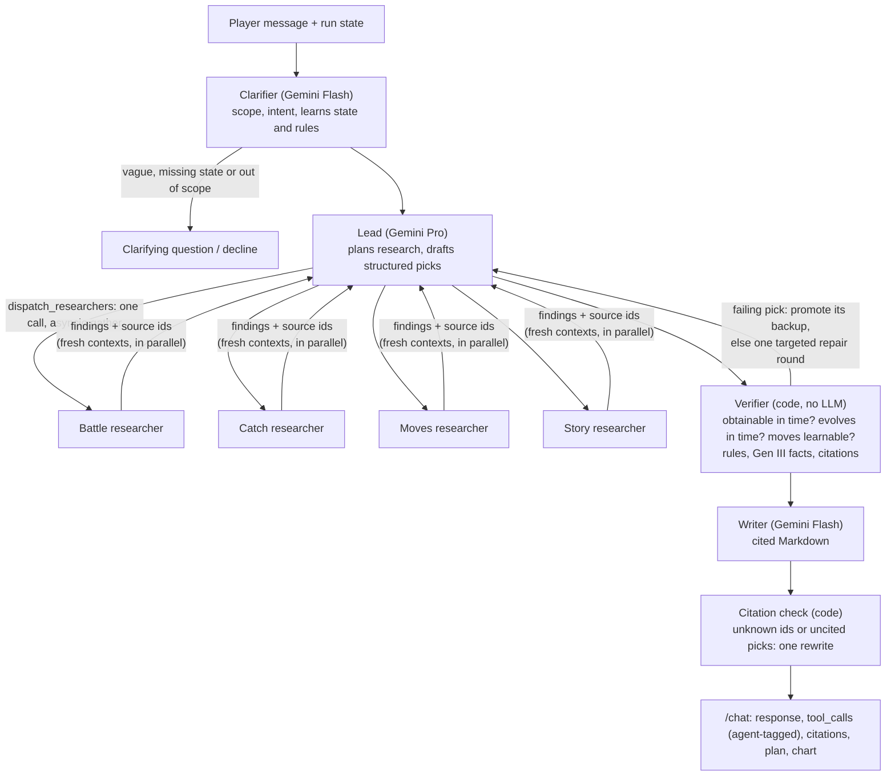

# LockeSmith

**A deep research agent for Pokémon Emerald, Ruby, Sapphire, FireRed and LeafGreen runs.** Tell it which game you're playing and where you are, and it researches what to catch next, what to do next, or how to get through the rest of the game. It checks every recommendation against that game's own data and cites it.

**Live:** https://lockesmith-816944548222.us-east4.run.app (Columbia accounts, through IAP) · **Course:** IEOR E4570 Agentic AI, Project 2, Deep Research path

## Who it's for

Players partway through Emerald, Ruby, Sapphire, FireRed or LeafGreen (the Game Boy Advance games), especially challenge runs:
- **Normal runs:** "What should I catch to get through Tate & Liza?"
- **Nuzlocke and custom rules:** one encounter per area, dupes clause, level caps, single-type runs, no legendaries, or any rule you type in plain words.
- **Randomized runs:** upload your Universal Pokémon Randomizer ZX spoiler log, and every answer uses *your* game's teams, encounters, TMs and evolutions.

Base models know Pokémon broadly and get the specifics wrong:
- The games differ more than they look:
  - Emerald's eighth gym leader is Juan; Ruby/Sapphire's is Wallace, whose Champion is Steven.
  - Every gym team differs between the games.
  - Ruby fights only Team Magma, Sapphire only Team Aqua.
  - In Ruby/Sapphire, Groudon or Kyogre is a required Lv45 battle before the eighth gym.
  - FireRed/LeafGreen cancel every evolution past #151 (Crobat, Steelix, Kingdra, Blissey, ...) until the postgame National Dex, and their wild Pokémon differ by version.
- Gen III decides physical vs special by a move's *type*, so Crunch is special and Sharpedo's 120 Attack can't use its own STAB.
- There's no Fairy type.
- Exact encounter tables, which areas a Nuzlocke has left, and anything in a randomized game.

LockeSmith answers from the data instead.

## How to use it

1. Open the site. Pick your **Game**, then fill in **Your run** on the left (starter and badges are required; party, rival, rules and a randomizer log are optional), or click one of the **Example** bubbles under the question box (hover one to see what it asks). One click fills in both the question and the run it needs. **What is this?** on the banner opens a short explainer.
2. Press **Ask**. Live progress shows each researcher working in its own lane. A catch plan takes a minute or two.
3. Read the answer:
   - pick cards (core vs. for-this-fight, where, when, backups)
   - the cited write-up, with `[n]` linking to its source
   - a type-coverage chart against every remaining major battle
   - the **research trace**: each round, the researchers side by side, and what the Verifier checked and changed
4. Follow up in the same conversation: "different picks, please", "I just beat Juan", "no Water types". The run panel updates with what the agent learned.

## Architecture



| Agent | Model | Job |
|---|---|---|
| Clarifier | Gemini 3.5 Flash | Gatekeeper. Declines out-of-scope questions, asks for missing starter or badges, classifies intent (catch, next steps, long plan, lookup, revision), and pulls state and rules out of the message ("I'm doing a Water monotype", "I'm playing Sapphire"). |
| Lead | Gemini 3.1 Pro | Plans the research. Sends 1–4 researchers out **in one call, in parallel, each in a fresh context**, reads their findings, may run a second round for gaps, and drafts structured picks with backups and source ids. On a follow-up it starts from the findings of earlier turns (their source ids stay citable) and researches only what they leave open. |
| Researchers ×4 | Gemini 3.5 Flash | **Battle:** teams, threats, coverage across the rest of the run. **Catch:** what's obtainable before a battle under the player's rules, and long-term value. **Moves:** learnsets, TMs obtainable in time, evolution timing. **Story:** next steps, the road to the Champion, walkthrough passages. |
| Verifier | code | Checks every pick and backup against the data. A failing pick is swapped for a passing backup, or sent back to the Lead once with the errors (the gap loop, 3 rounds max). Picks that still fail are dropped with the reason shown. It also rewrites any "where to catch it" line that disagrees with the encounter tables (place, method, odds) from the data, and flags type-matchup claims that the Gen III chart and abilities contradict ("double-resists Water", "Ice Beam does 4x to Breloom", Dig as "an answer to" a Levitating Gengar), in picks, battle notes and steps, for the Writer to fix. |
| Writer | Gemini 3.5 Flash | Turns the verified draft into a cited answer; citations are then checked in code, with one retry. |

Researchers use **composite tools** (`scout_battle`, `get_catchable`, `moves_outlook`, `assess_candidates`, `gauntlet_overview`, …). Code does the arithmetic (type charts, encounter odds, story gates); the agents decide what to investigate. Every tool result carries source ids, and only ids that a tool actually returned can be cited. Design decisions and their reasons are in [docs/decisions.md](docs/decisions.md).

**Show its work:** `/chat` keeps the Project 1 response shape. Sub-agent tool calls appear in `tool_calls` with an `agent` field: `clarifier`, `lead`, `battle_researcher`, …, `verifier`. `POST /chat/stream` streams the same turn as server-sent events for the progress view.

## Data

Built offline into one database per game, `data/emerald.duckdb`, `ruby`, `sapphire`, `firered` and `leafgreen` (about 7 MB each, committed), by `uv run python build/build_db.py` (every game, or one with `--game firered`). Sources are fetched at pinned commits (`data/sources.lock.json`) by `build/fetch_sources.py`. They share one schema, and a session reads the database of its run's game.

| Source | What it gives | Version / license |
|---|---|---|
| [pret/pokeemerald](https://github.com/pret/pokeemerald) decompilation | Ground truth for Emerald: every trainer team (levels, held items, custom moves, AI), wild encounter tables and their ROM order, TM/HM and move-tutor locations with what each needs (HMs, keys, side quests), static-encounter conditions, the friendship threshold | commit `731ad5bf`; decompiled game code, used as reference data |
| [pret/pokeruby](https://github.com/pret/pokeruby) decompilation | The same for Ruby and Sapphire. It builds either game from one tree, and the build reads each version's own wild tables, script branches and `constants/version.inc` aliases (e.g. Maxie vs. Archie at Mt. Chimney). | commit `5784633c`; decompiled game code, used as reference data |
| [pret/pokefirered](https://github.com/pret/pokefirered) decompilation | The same for FireRed and LeafGreen, from one tree with pokeemerald's layout: each version's wild tables, trades and Game Corner prizes, Kanto's move tutors (Cape Brink's included), and the National Dex evolution gate | commit `ce6406d8`; decompiled game code, used as reference data |
| [PokeAPI](https://github.com/PokeAPI/pokeapi) CSVs | Species, moves, Gen III learnsets, evolutions, encounter rows, the type chart | commit `6b8db7f3`; BSD-3-Clause, data from the games |
| Bulbapedia's [Emerald](https://bulbapedia.bulbagarden.net/wiki/Walkthrough:Pok%C3%A9mon_Emerald), [Ruby and Sapphire](https://bulbapedia.bulbagarden.net/wiki/Walkthrough:Pok%C3%A9mon_Ruby_and_Sapphire) and [FireRed and LeafGreen](https://bulbapedia.bulbagarden.net/wiki/Walkthrough:Pok%C3%A9mon_FireRed_and_LeafGreen) walkthroughs | 400, 392 and 360 passages for story steps and route context, searched with BM25; passages of a version pair are tagged with the version they describe | CC BY-NC-SA 2.5, attributed in every citation |
| `data/progression.yaml`, `progression_rs.yaml` and `progression_frlg.yaml` (hand-built, checked against the decomp) | The story battles in order (32 in Emerald, 29 steps in Ruby/Sapphire, 26 in FireRed/LeafGreen), what each opens (areas, HMs, key items, encounter methods) and each game's quirks (deferred gyms, double battles, rival variants; in Ruby/Sapphire the forced legendary and the story events that gate areas) | cites the decomp and walkthrough per entry; each file's facts were checked claim by claim against the decomp (`docs/review_packet*.md`) |
| Your randomizer log (optional upload) | Randomized wild sets, trainer teams, TM and tutor moves, stats and types, evolutions, starters, statics | parsed per session into views over the vanilla tables (`agent/overlay.py`) |

**PokeAPI is corrected to Gen III where it reflects later games** (`build/gen3_corrections.py`, tested in `tests/test_gen3_facts.py`), with the decomp as ground truth:
- past types, stats and abilities
- move power, PP, accuracy and type as of Gen III, with the category taken from the type
- no Fairy type
- the 220 friendship threshold, not 160
- regional and Gen IV evolutions removed
- PokeAPI's wrong static encounters fixed (duplicated and misplaced Voltorb and Electrode in the Hoenn games)

Ruby and Sapphire need no extra Gen III rules. Their species, moves, type chart, learnsets (except event-only Deoxys) and evolutions match Emerald's, which `tests/test_rs_facts.py` checks against pokeruby. FireRed and LeafGreen add one: before the National Dex, no evolution goes past #151 (`agent/games.py` `evolution_limit`, from `evolution_scene.c`); `tests/test_frlg_facts.py` checks their databases against pokefirered. [docs/decisions.md](docs/decisions.md) ("Data findings", D13 and D16) lists what the cross-checks found.

**Loading the data.** The five databases are committed, so after `uv sync` any of them opens directly:

```bash
uv run python -c "import duckdb; print(duckdb.connect('data/emerald.duckdb', read_only=True).sql('SHOW TABLES'))"
```

The tables behind the sample answers below are `trainer_mons` (every trainer's team, with levels, items and moves), `encounters` (wild tables, with method and rate) and `type_efficacy` (the Gen III type chart); `learnsets`, `evolutions` and `tm_locations` cover moves. To rebuild everything from the pinned sources, run `uv run python build/fetch_sources.py`, then `build/build_db.py`, then `build/build_guide_corpus.py` (the walkthrough passages, rebuilt from the saved pages in `data/guide*/pages.jsonl`).

**How the story gates were checked.** What each story battle opens (areas, HMs, key items) was checked against the decomps' map scripts and engine code: claim by claim (`docs/review_packet*.md`), and for Ruby/Sapphire also by a mechanical comparison with Emerald (`uv run python -m audit`, reports in [docs/audit/](docs/audit/)). None of it was checked by playing the games in an emulator.

## Sample queries

Each sample is one click on the site: **Examples 1, 2 and 3** under the question box. Hovering one shows what it is, and clicking it fills in the question **and** the run state. Sample 1 is a Ruby run; samples 2 and 3 are Emerald. The example list also has a vanilla Emerald catch plan, a Sapphire catch plan, a FireRed catch plan and a LeafGreen evolution question, whose answers and baselines are in [docs/samples/](docs/samples/) and [docs/baseline/](docs/baseline/). For each sample, the table below gives:
- the **expected answer**, generated from the game's database by [`scripts/expected_answers.py`](scripts/expected_answers.py) ([docs/samples/expected.md](docs/samples/expected.md)), with the files and tables it comes from
- the **baseline**: Gemini 3.5 Flash with no tools and no system prompt, given the run state in words ([`scripts/baseline.py`](scripts/baseline.py)). Flash runs most of LockeSmith: the Clarifier, the four researchers and the Writer. The Lead uses Gemini 3.1 Pro.
- **LockeSmith's answer**, from `POST /chat` ([`scripts/run_samples.py`](scripts/run_samples.py); traces in [docs/samples/](docs/samples/))

Every baseline claim called wrong below was checked against the game's data. The full baseline and LockeSmith answers are in the collapsed sections under each table. These are the runs of Nov 16, with the code as submitted.

### 1. Ruby Nuzlocke: should I catch Groudon?

> **Run:** Ruby, Mudkip, rival May, 7 badges; party Swampert 41, Breloom 38, Swellow 38, Manectric 37; **Nuzlocke with level caps**.
> **Question:** *Ruby Nuzlocke with level caps. Should I catch Groudon in the Cave of Origin, and what else do I need for Wallace?*

| | |
|---|---|
| **Expected** (`data/ruby.duckdb`: `trainer_mons`, `type_efficacy`, `encounters` via `get_catchable`; story order from `data/progression_rs.yaml`) | Groudon is a required **Lv45** battle in the Cave of Origin before the gym. Wallace's ace is Milotic Lv43, so the **level cap is 43**, and a caught Groudon can't be used against him. Ruby's Wallace: Luvdisc 40, Whiscash 42 (Earthquake), Sealeo 40 (Aurora Beam), Seaking 42 (Horn Drill), Milotic 43 (Ice Beam, Recover). Grass hits all five super-effectively, Electric four. Catchable: Magnemite/Voltorb (New Mauville, 50%), Oddish (Safari Zone, 40%; Route 119, 30%), Chinchou (Route 124/126 seaweed, 30%). |
| **Baseline** ([full](docs/baseline/ruby-nuzlocke-groudon.md)) | Gets the Groudon part right (Lv45, over the cap, so box it), then **answers from the wrong game**. Its Wallace has a Lv43 **Crawdaunt**, which is Juan's Pokémon in Emerald; Ruby's Wallace has Seaking. It builds its advice around Milotic's **Toxic** and **Surf**, moves Milotic doesn't have (it has Water Pulse, Twister, Recover and Ice Beam). And it says to catch Chinchou **with the Super Rod**; Chinchou are only in underwater seaweed, reached with Dive. No sources. |
| **LockeSmith** ([full](docs/samples/ruby-nuzlocke-groudon.md)) | Catch Groudon (statics are free under these rules) but box it: Lv45 is over the cap of 43 (knocking it out or fleeing also clears the story event). Picks **Magnemite → Magneton** (New Mauville, 49–50%) with **Chinchou → Lanturn** (Route 124/126 seaweed, 30%) as the backup, and **Oddish → Vileplume** (Safari Zone 40%, Route 119 30%) for Whiscash's 4× Grass weakness, flagging the Leaf Stone it needs. It gives Ruby's real Wallace team, with Sealeo's Aurora Beam and Milotic's Ice Beam, and notes that Manectric's Lv45 Thunder is out of reach under the cap. The Verifier dropped a Spheal backup because Walrein needs Lv44, over the cap. 22 cited sources plus a coverage chart. |

<details>
<summary>Baseline's full answer (Gemini 3.5 Flash, no tools, no system prompt)</summary>

Here is the breakdown to help you make the best decisions for your Ruby Nuzlocke, keeping your level caps and rules in mind.

---

**Part 1: Should you catch Groudon in the Cave of Origin?**
**Yes, you should catch it, but you CANNOT use it for Wallace.**

Here is why:
1. **The Level Cap Rule:** In Pokémon Ruby, Groudon is caught at **Level 45**. Wallace’s highest-level Pokémon (Milotic and Crawdaunt) are **Level 43**. Bringing Groudon to the Wallace fight would violate your level cap rule.
2. **Type Disadvantage:** Even if you bent the level cap rule, Groudon is a Ground-type facing a Water-type gym. While its *Drought* ability weakens Water-type attacks, Groudon is still at risk of taking neutral super-effective-equivalent damage, and it doesn't have a natural type advantage here.
3. **Save it for later:** You should absolutely still catch Groudon as your Cave of Origin encounter. Put it in the PC. Once you beat Wallace, the level cap will jump to **Lv. 58** (Steven’s Metagross). Groudon will be an incredibly powerful asset for the Elite Four and Steven.

---

**Part 2: What else do you need for Wallace?**
Wallace's team in Pokémon Ruby is:
*   **Luvdisc** (Lv. 40 - Water)
*   **Sealeo** (Lv. 40 - Ice/Water)
*   **Whiscash** (Lv. 42 - Water/Ground)
*   **Crawdaunt** (Lv. 43 - Water/Dark)
*   **Milotic** (Lv. 43 - Water)

Your current party is only 4 Pokémon. **You have 2 empty slots.** Since you are playing a Nuzlocke, you need to look at your PC and your remaining encounters to fill these slots.

**1. Recommended Additions to your Team**
*   **Tentacruel (Water/Poison):** Tentacool is incredibly easy to catch via Surf on almost any water route. Tentacruel has massive Special Defense, resists Water and Ice-type moves, and is immune to Milotic’s *Toxic*. It is the ultimate "pivot" Pokémon for this fight to safely absorb hits.
*   **Chinchou/Lanturn (Water/Electric):** If you can catch one (by fishing with the Super Rod on Route 124/126), Lanturn is a cheat code for this gym. It resists Water and Ice, and hits back with Super-Effective Electric moves.
*   **A "Sack" or Backup Grass-type:** If you have an Oddish/Gloom (from Safari Zone or Route 119), evolve it into Vileplume or Bellossom. Having a backup Grass-type is great security in case something happens to Breloom.

**2. Strategy for your Current Party (Level Cap: 43)**
First, **level up your team!** Bring Manectric, Breloom, and Swellow up to **Level 42 or 43**.

*   **Manectric (The Sweeper):**
    *   *Role:* Your primary weapon against Luvdisc, Sealeo, Crawdaunt, and Milotic.
    *   *Tip:* Ensure it has **Thunderbolt** (obtained from Wattson after doing the New Mauville sidequest). Do *not* rely on Spark.
    *   *Danger:* **Do not use Manectric against Whiscash.** Whiscash is Ground-type and immune to Electric. Also, Wallace's Milotic is incredibly bulky; if Manectric cannot OHKO it, Milotic can hit back hard with Surf or poison you with Toxic.
*   **Breloom (The Whiscash Slayer):**
    *   *Role:* To deal with Whiscash and Crawdaunt.
    *   *Tip:* Gen 3 does *not* have the physical/special split yet. Grass is Special (Breloom’s weaker stat), but a Grass move (like **Mega Drain** or **Giga Drain** from TM19 on Route 123) will still easily 4x OHKO Whiscash because of Whiscash's double-weakness.
    *   *Danger:* Watch out for Sealeo’s *Aurora Beam* and Milotic’s *Ice Beam*. They will do massive damage to Breloom. Do not keep Breloom in against them. Use **Mach Punch** or **Sky Uppercut** to quickly delete Crawdaunt.
*   **Swampert (The Tank):**
    *   *Role:* High-HP pivot. If Manectric or Breloom gets into trouble, Swampert can safely switch in to take a hit. It resists nothing here, but its sheer bulk makes it safe.
*   **Swellow (The Bench Warmer):**
    *   *Role:* Keep Swellow away from this fight. Sealeo and Milotic carry Ice-type moves that will easily OHKO Swellow. Only use it as a last-resort sacrifice if things go horribly wrong.

**Summary Checklist for Wallace:**
1. **Level up** Manectric, Breloom, and Swellow to Level 42.
2. Teach Manectric **Thunderbolt** (if it doesn't have it).
3. Teach Breloom a Grass-type TM (like **Giga Drain**) specifically for Whiscash.
4. Catch and train a **Tentacruel** to Lv. 42 to act as your Special Defense wall against Milotic.
5. Catch Groudon, but leave it in the PC until after the Gym Badge is yours.

</details>

<details>
<summary>LockeSmith's full answer, with its sources</summary>

You can catch Groudon to use later, but its Level 45 encounter violates Wallace's Level 43 cap, so you must box it for the Gym and rely on your party and new encounters [1][2].

**Top picks**
**Magneton (from Magnemite) — *core* [3][4]**
* **Where:** New Mauville (walk, Lv22-26, 49-50% encounter rate) [5].
* **When:** Available immediately (requires Surf to access New Mauville) [3].
* **Why it helps now:** Evolves into Magneton at level 30 [3][4]. Its massive Special Attack and Electric typing allow it to sweep through most of Wallace's Water-types [3][4]. Its Steel typing grants invaluable defensive resistances against Ice-type moves like Milotic's Ice Beam [3][4].
* **Key Moves:** Thunderbolt [3].
* **Long run:** Outstanding against Glacia (resists Ice) and useful against Steven's Skarmory, Cradily, and Armaldo, though it must avoid Ground-type attacks due to a 4x weakness [3][4].
* **Backup:** **Lanturn** (from Chinchou, Route 124 or 126 Underwater in seaweed, Lv20-30, 30%) [6]. Its Volt Absorb ability and Water/Electric typing make it a perfect defensive wall against other Water-types, taking minimal damage while striking back with super-effective Electric moves [7][8]. It has an incredible matchup against Glacia's Water-types and Steven's Skarmory, though lower offensive stats mean it relies on matching up defensively [7][8].

**Vileplume (from Oddish) — *core* [9][10]**
* **Where:** Safari Zone SE/SW (walk, Lv25-27, 40%) or Route 119 (walk, Lv24-27, 30%) [11].
* **When:** Available immediately [9].
* **Why it helps now:** Wallace's Whiscash is immune to Electric attacks and can threaten your Electric-types with Ground moves [9][2]. A Grass-type like Vileplume or Bellossom will hit Whiscash for 4x super-effective damage [9][10][12]. *Note: Vileplume needs a Leaf Stone; ensure you can acquire one before the battle.*
* **Key Moves:** Giga Drain, Sleep Powder [9].
* **Long run:** Extremely useful for countering heavy Ground- and Rock-types in Steven's champion team [9].
* **Backup:** None.

---

**Key Battles**
**Groudon (Cave of Origin)**
The Cave of Origin encounter with Groudon is a mandatory story event [1]. You do not have to catch it; defeating it or fleeing will also clear the event and unlock Sootopolis Gym [1][2]. If you do catch it, it is encountered at Level 45, which exceeds Wallace's Level 43 cap, meaning you must keep it in the PC for the Gym battle [1][2].

**Gym 8 Leader: Wallace**
Wallace leads with Luvdisc (Lv40) and has Whiscash (Lv42), Sealeo (Lv40), Seaking (Lv42), and Milotic (Lv43) [13][14][15][16][17].
* **Whiscash** is immune to Electric and carries Ground moves [14][18]. Your Breloom provides a great answer, learning Sky Uppercut at Level 36 [19], while a Grass-type like Vileplume can hit its 4x Grass weakness [9][18].
* **Sealeo** (Aurora Beam) and **Milotic** (Ice Beam) can hit your Grass and Flying types (Breloom, Swellow) for super-effective damage [15][17][18].
* **Manectric** is perfectly positioned to sweep much of Wallace's team, learning Bite at Level 39 [20]. It learns Thunder at Level 45, but this will be unavailable due to the Level 43 cap [21][2].

---

**Assumptions**
* You are allowing the use of legendary Pokémon as long as they adhere to your level caps [22].
* You have not already exhausted your encounters in New Mauville or the Safari Zone [22].

**To sharpen this**
* What are the current movesets of your Swampert, Breloom, Swellow, and Manectric?
* Do you already have a Leaf Stone or Sun Stone to evolve a Gloom?

**Not covered**
* Whether your specific Nuzlocke ruleset bans legendary Pokémon altogether, regardless of level caps [22].

**Rules I followed**
- Nuzlocke: first encounter per named location only; gifts, statics and trades are free (checked by the Verifier)
- level caps: stay at or below the next boss's highest level (checked by the Verifier)

**Sources**
1. Story progression (data/progression_rs.yaml): Cave of Origin: Groudon (Lv45) (`progression:legendary_cave_of_origin`)
2. Story progression (data/progression_rs.yaml): Sootopolis Gym: Wallace (`progression:gym8_wallace`)
3. PokeAPI: Magnemite (species data) (`pokeapi:pokemon_species#81`)
4. PokeAPI: Magneton (species data) (`pokeapi:pokemon_species#82`)
5. PokeAPI: Magnemite at New Mauville (walk) (`pokeapi:encounters#27243`)
6. PokeAPI: Chinchou at Route 124 (seaweed) (`pokeapi:encounters#27832`)
7. PokeAPI: Chinchou (species data) (`pokeapi:pokemon_species#170`)
8. PokeAPI: Lanturn (species data) (`pokeapi:pokemon_species#171`)
9. PokeAPI: Oddish (species data) (`pokeapi:pokemon_species#43`)
10. PokeAPI: Vileplume (species data) (`pokeapi:pokemon_species#45`)
11. PokeAPI: Oddish at Safari Zone (walk) (`pokeapi:encounters#28074`)
12. PokeAPI: Bellossom (species data) (`pokeapi:pokemon_species#182`)
13. pokeruby src/data/trainer_parties.h (gTrainerParty_Wallace/1) (`decomp:trainer_parties.h#gTrainerParty_Wallace/1`)
14. pokeruby src/data/trainer_parties.h (gTrainerParty_Wallace/2) (`decomp:trainer_parties.h#gTrainerParty_Wallace/2`)
15. pokeruby src/data/trainer_parties.h (gTrainerParty_Wallace/3) (`decomp:trainer_parties.h#gTrainerParty_Wallace/3`)
16. pokeruby src/data/trainer_parties.h (gTrainerParty_Wallace/4) (`decomp:trainer_parties.h#gTrainerParty_Wallace/4`)
17. pokeruby src/data/trainer_parties.h (gTrainerParty_Wallace/5) (`decomp:trainer_parties.h#gTrainerParty_Wallace/5`)
18. Gen 3 type chart (pokeruby data/type_effectiveness.inc) (`rules:gen3_type_chart`)
19. PokeAPI: Breloom learns Sky Uppercut (level-up) (`pokeapi:pokemon_moves#286/327/level-up/36`)
20. PokeAPI: Manectric learns Bite (level-up) (`pokeapi:pokemon_moves#310/44/level-up/39`)
21. PokeAPI: Manectric learns Thunder (level-up) (`pokeapi:pokemon_moves#310/87/level-up/45`)
22. LockeSmith's Ruby rules (agent/brief.py, checked in docs/audit/engine.txt) (`rules:game`)

</details>

### 2. Nuzlocke into Juan

> **Run:** Emerald, Mudkip, rival May, 7 badges; party Swampert 42, Breloom 40, Swellow 40, Manectric 39; **Nuzlocke, dupes clause, level caps**, with 23 areas already used.
> **Question:** *Nuzlocke with the dupes clause and level caps. Juan is next; what should I catch?*

| | |
|---|---|
| **Expected** (`data/emerald.duckdb`: `trainer_mons` for Juan's team and so the level cap, `type_efficacy`, `encounters` via `get_catchable` with the used areas removed) | Juan: Luvdisc 41, Whiscash 41, Sealeo 43, Crawdaunt 43, **Kingdra 46** (Water Pulse, Double Team, Ice Beam, Rest; Chesto Berry). That makes the **level cap 46**. Grass hits 4 of 5 super-effectively, Electric 3. Still catchable in unused areas: Magnemite/Voltorb (New Mauville, 50%), Chinchou (Route 124 seaweed, 30%), Oddish (Route 123), Lileep (fossil gift). |
| **Baseline** ([full](docs/baseline/nuzlocke-juan.md)) | Sensible picks (Lanturn, Magneton, Walrein) from unused areas, but it **gets Juan's team wrong** and plans the fight around it: it gives Sealeo **Blizzard** (Juan's Sealeo has Aurora Beam) and Crawdaunt **Swords Dance** (it has Taunt and Leer). It puts Chinchou on **Route 127** (only Routes 124 and 126 have them), and it says to surf for Spheal in Shoal Cave, calling it "a very common encounter"; surfing finds Spheal 10% of the time, at high tide only, while walking finds them 50%. No sources. |
| **LockeSmith** ([full](docs/samples/nuzlocke-juan.md)) | **Spheal → Walrein** (Shoal Cave, walking, 50%) and **Chinchou → Lanturn** (Route 124 seaweed, 30%, once Dive is usable), with backups **Staryu → Starmie** (Lilycove, Super Rod, 15%; flags the Water Stone) and **Magnemite** (New Mauville). Each place was checked against the 23 used areas, the dupes clause and the level cap of 46, and a "Rules I followed" section lists what the Verifier checked. The battle notes give Kingdra's real stall set (Double Team, Ice Beam, Rest, Chesto Berry) and Whiscash's Earthquake against Electric types. 17 cited sources plus a coverage chart. |

<details>
<summary>Baseline's full answer (Gemini 3.5 Flash, no tools, no system prompt)</summary>

You are in a great position, but Juan’s gym is notoriously dangerous—not because his team is overwhelming, but because of his final Pokémon: **Kingdra**.

Juan’s **Kingdra (Lv. 46)** runs a highly annoying stall set: **Double Team, Rest (holding a Chesto Berry), Water Pulse, and Ice Beam**. If it gets a few Double Teams off, it can easily sweep your entire team through evasion.

Since your level cap for this fight is **46**, you have plenty of room to train. Here are the best encounters you can grab right now to secure a deathless victory, followed by a strategy for the fight.

---

**Best Encounters to Grab Right Now**
**1. The Best Choice: Chinchou / Lanturn (Route 124, 126, or 127 - Underwater)**
* **How to get it:** Use **Dive** in the seaweed of Route 124, 126, or 127. If you use the Dupes Clause to ignore Tentacool/Clamperl, you have an incredibly high chance of finding Chinchou.
* **Why it’s amazing:** Lanturn is a Water/Electric type with a massive HP pool. It **resists both Water and Ice**, meaning Juan's Kingdra and Sealeo can barely scratch it. It can comfortably chip away at Kingdra and easily dispatch Luvdisc, Sealeo, and Crawdaunt with Thunderbolt. *Bonus: It is also the ultimate counter to the Champion, Wallace.*

**2. The Guaranteed Choice: Magnemite / Magneton (New Mauville)**
* **How to get it:** Surf from Route 110 to the entrance of New Mauville. Inside, you have a 100% encounter rate for the Magnemite or Voltorb lines.
* **Why it’s amazing:** Magneton (Electric/Steel) is a fantastic pivot. Steel-type **resists Ice Beam**, meaning Sealeo and Kingdra cannot hit it hard. Magneton’s massive Special Attack stat makes short work of Juan’s Water-types.

**3. The Future-Proof Choice: Spheal / Walrein (Shoal Cave - North of Mossdeep)**
* **How to get it:** Surf inside Shoal Cave. Spheal is a very common encounter.
* **Why it’s amazing:** While not the absolute best counter to Juan (it’s Water/Ice), Walrein is incredibly bulky, has the *Thick Fat* ability (halving Ice/Fire damage), and is an absolute **must-have** for the Elite Four, especially against Drake's Dragon-types later.

*Note on PC Box:* If you happened to catch a **Nincada** on Route 116 earlier and evolved it into **Shedinja**, check its moves. Kingdra's only attacking moves are Water Pulse (Water) and Ice Beam (Ice). **Shedinja is completely immune to both**. If you have Shedinja, you can send it out against Kingdra and slowly chip it to death with absolute safety.

---

**Strategic Strategy for Juan (Level Cap: 46)**
Bring your team up to **Level 45-46**. Your current party actually has the perfect tools to dismantle Juan if you play smart.

**1. The Lead: Luvdisc (Lv. 41)**
* **The Threat:** Attract, Sweet Kiss (Confusion stall).
* **The Counter:** Lead with **Manectric** (or Magneton/Lanturn if you caught one). Thunderbolt or Spark should easily 1-shot it before it can confuse you.

**2. Whiscash (Lv. 41)**
* **The Threat:** Amnesia and Earthquake. Immune to Electric.
* **The Counter:** Switch immediately to **Breloom**. Whiscash is 4x weak to Grass. A single **Giga Drain** or Bullet Seed will instantly delete it.

**3. Sealeo (Lv. 43) and Crawdaunt (Lv. 43)**
* **The Threat:** Sealeo has Blizzard/Body Slam; Crawdaunt has Crabhammer/Swords Dance.
* **The Counter:** Use **Manectric** (or your new Electric encounter). Do not use Breloom against Sealeo, as Blizzard will do massive damage. Manectric outspeeds both and should comfortably 1-shot or 2-shot them with Electric moves.

**4. The Boss: Kingdra (Lv. 46)**
* **The Threat:** Double Team evasion spam.
* **The Strategy:** Evasion bypass is your secret weapon here.
    * **Swellow** naturally learns **Aerial Ace** at Level 38 (or via TM). **Aerial Ace cannot miss**, completely bypassing Kingdra's Double Team.
    * **Manectric** can be taught **Shock Wave** (TM34 from Wattson). **Shock Wave also cannot miss**.
    * **How to execute:** If you have **Lanturn**, you can slow-poison Kingdra with Toxic (TM06 from Fiery Path) and stall it out because Lanturn resists all of Kingdra's attacks. Otherwise, use Manectric to hit it hard, and if it starts spamming Double Team, pivot to Swellow or Manectric to spam **Aerial Ace / Shock Wave** until it goes down.

Good luck! Secure that Chinchou or Magnemite, get your team to Level 45, and the Rain Badge is yours.

</details>

<details>
<summary>LockeSmith's full answer, with its sources</summary>

Target Spheal in Shoal Cave and Chinchou on Route 124 underwater to prepare for Juan's Level 46 cap [1].

**Top picks**
**Spheal (Tank / Ice Attacker) — **Core** [2]**
* **Where:** Shoal Cave, Walking (Lv26-32, 50% rate, guaranteed if you have Zubat/Golbat) [3][4][5]
* **When:** Available immediately, but evolve before Lv46 [6]
* **Why:** With Thick Fat, Walrein minimizes Ice-type damage and has the bulk to take on Juan's stalling team safely [2][6].
* **Long run:** Essential for defeating Drake of the Elite Four with powerful Ice-type moves [6].
* **Backup:** Staryu (Lilycove City via Super Rod, 15% rate) [7]. Starmie is incredibly fast with deep coverage (Thunderbolt, Ice Beam, Surf) to sweep [8]. *Note: Starmie requires a Water Stone; make sure you can obtain one before facing Juan.*

**Chinchou (Electric/Water Pivot) — **Core** [9]**
* **Where:** Route 124 (underwater), Seaweed (Lv20-30, 30% rate) [10]
* **When:** Available as soon as Dive is usable (after Space Center) [11]
* **Why:** Lanturn's typing resists Water and Ice, and it hits Juan's team super-effectively with STAB Electric moves [9][6].
* **Long run:** Volt Absorb and excellent HP make Lanturn an incredible tank and pivot against Wallace and Glacia [9][12].
* **Backup:** Magnemite (New Mauville, ~49% rate) [13]. Magneton offers high Special Attack to clear Water-types (though it must dodge Whiscash's Earthquake) and key Steel-type resistances for the Elite Four [14][15].

---

**Key Battles**
**Gym 8: Juan**
* Juan's team is capped at Level 46 (Kingdra) [16].
* Whiscash knows Earthquake, which threatens Electric-type counters [17].
* Kingdra stalls with Double Team, Ice Beam, Rest, and a Chesto Berry, requiring high bulk or burst damage to overcome safely [16].

---

**Assumptions**
* You have not caught Zubat or Golbat yet, but encountering them triggers the dupes clause for a guaranteed Spheal encounter.

**To sharpen this**
* Do you already have a Zubat or Golbat registered in your Pokédex?
* Do you have the Storage Key for the Abandoned Ship to access TM13 Ice Beam?

**Not covered**
* Other potential encounter areas requiring HMs not yet unlocked.

**Rules I followed**
- Nuzlocke: first encounter per named location only, dupes clause; gifts, statics and trades are free (checked by the Verifier)
- encounters already used: Route 101, Route 102, Route 103, Route 104, Petalburg Woods, Route 116, Rusturf Tunnel, Granite Cave, Route 110, Route 117, Route 111, Route 112, Fiery Path, Route 113, Route 114, Meteor Falls, Route 115, Route 118, Route 119, Route 120, Route 121, Safari Zone, Mt. Pyre (checked by the Verifier)
- level caps: stay at or below the next boss's highest level (checked by the Verifier)

**Sources**
1. LockeSmith's Emerald rules (agent/brief.py) (`rules:game`)
2. PokeAPI: Spheal (species data) (`pokeapi:pokemon_species#363`)
3. PokeAPI: Spheal at Shoal Cave (walk) (`pokeapi:encounters#30883`)
4. PokeAPI: Spheal at Shoal Cave (walk) (`pokeapi:encounters#70746`)
5. PokeAPI: Zubat at Shoal Cave (walk) (`pokeapi:encounters#70741`)
6. database query a490601260 (`sql:a490601260`)
7. PokeAPI: Staryu at Lilycove City (super-rod) (`pokeapi:encounters#30913`)
8. PokeAPI: Staryu (species data) (`pokeapi:pokemon_species#120`)
9. PokeAPI: Chinchou (species data) (`pokeapi:pokemon_species#170`)
10. PokeAPI: Chinchou at Route 124 (seaweed) (`pokeapi:encounters#29872`)
11. Story progression (data/progression.yaml): Mossdeep Space Center: Maxie & Tabitha (multi battle with Steven) (`progression:space_center`)
12. database query b86cf59b31 (`sql:b86cf59b31`)
13. PokeAPI: Magnemite at New Mauville (walk) (`pokeapi:encounters#30487`)
14. PokeAPI: Magnemite (species data) (`pokeapi:pokemon_species#81`)
15. database query 86f8f978ec (`sql:86f8f978ec`)
16. pokeemerald src/data/trainer_parties.h (sParty_Juan1/5) (`decomp:trainer_parties.h#sParty_Juan1/5`)
17. pokeemerald src/data/trainer_parties.h (sParty_Juan1/2) (`decomp:trainer_parties.h#sParty_Juan1/2`)

</details>

### 3. Randomized gym

> **Run:** Emerald, Mudkip, rival May, 6 badges; party Marshtomp 33, Breloom 30, Swellow 31, Manectric 30; plus the uploaded **sample randomizer log** ([static/samples/fire-tate-liza.log](static/samples/fire-tate-liza.log)), in which Tate & Liza use Fire types.
> **Question:** *What should I catch to get through Tate & Liza?*

| | |
|---|---|
| **Expected** (the log, read into a session view of `trainer_mons`; `type_efficacy`; `encounters` via `get_catchable`) | Camerupt 41, Torkoal 41, Magcargo 42 and Houndoom 42 (Sitrus Berries on the last two). Water and Ground hit all four super-effectively. Wild Pokémon are vanilla in this log: Carvanha/Sharpedo, Barboach (Super Rod: Routes 111, 114, 120), Spheal and others. |
| **Baseline** ([full](docs/baseline/randomizer-tate-liza.md)) | Reads the log's team right, since the whole sample log fits in its prompt, and goes for Water moves and a double Surf. But **its catch advice is wrong in four places**. It says Spheal takes **1/4** damage from Fire; Ice cancels Water's resistance, so it's 1/2 even with Thick Fat. It says Tentacruel can be caught surfing Routes 124–126; wild Tentacruel are only at the Abandoned Ship. It puts Staryu on Route 124 (only Lilycove has them), and says Gyarados can be fished "in any body of water"; wild Gyarados are only in Sootopolis, which opens after this gym. No sources. |
| **LockeSmith** ([full](docs/samples/randomizer-tate-liza.md)) | Reads the team from the log (cited as "Your randomizer log: Leader Tate&Liza's team"), with the level-up moves UPR gives randomized trainers (Camerupt's Earthquake and Rock Slide). Picks **Staryu → Starmie** (Lilycove, Super Rod, 15%; flags the Water Stone) with **Spheal** (Shoal Cave, 50%) as the backup, and **Carvanha → Sharpedo** (Super Rod, Route 119 100% or Route 118 60%), noting that Surf and Crunch are special in Gen III against Sharpedo's higher Attack. 11 cited sources plus a coverage chart. A real UPR log lists every trainer and wild table (LockeSmith's full-size Emerald test log is over 6,000 lines), and LockeSmith reads any of it the same way. |

<details>
<summary>Baseline's full answer (Gemini 3.5 Flash, no tools, no system prompt)</summary>

This is an incredibly favorable matchup for you! Tate & Liza being randomized to **Fire-types** is the best-case scenario for a player who picked Mudkip, but your current party is heavily underleveled (your highest is Lv. 33, while their team is Lv. 41-42).

In Generation 3 double battles, **Surf hits both opponents but does NOT hit your partner**. This means running two Water-types side-by-side and spamming Surf is the ultimate strategy to easily sweep their entire team, as every single one of their Pokémon is weak (or 4x weak) to Water.

Here is exactly what you should catch, prepare, and do to easily win this gym badge.

---

**Step 1: Evolve your Marshtomp**
Before catching anything else, **level Marshtomp up to Level 36 so it evolves into Swampert**.
* Swampert gets a massive stat boost, making it incredibly bulky.
* Teach it **Surf (HM03)**.
* **Camerupt** and **Magcargo** both take **4x damage** from Water, meaning Swampert's Surf will likely one-shot them instantly.

---

**Step 2: What to Catch (Choose 1 or 2)**
Since you are already in the Mossdeep City area, you have access to some of the best Water-type Pokémon in the game. Here are the best encounters you can grab right now:

**1. Spheal / Sealeo (Highly Recommended)**
* **Where to catch:** Shoal Cave (just north of Mossdeep City).
* **Why:** You can catch them around Lv. 26–32. Spheal's ability **Thick Fat** halves Fire-type damage. Combined with its Water typing, **it takes only 1/4 damage from Fire-type attacks**. It is incredibly bulky, resists everything Tate & Liza will throw at it, and can spam Surf alongside Swampert.

**2. Tentacool / Tentacruel**
* **Where to catch:** Surf on Route 124, 125, or 126 (right outside Mossdeep). You can encounter Tentacruel directly in the wild, or catch a high-level Tentacool.
* **Why:** Tentacruel has a massive **Base 120 Special Defense**. Because Fire is a Special type in Gen 3, Tentacruel will take almost no damage from their attacks. It is also very fast and can easily outspeed Houndoom to hit it with Surf.

**3. Staryu / Starmie**
* **Where to catch:** Fish with a Super Rod in Lilycove City or Route 124.
* **Why:** If you want raw power, Starmie is unmatched. It is incredibly fast and has high Special Attack.
* *Note:* You can evolve it immediately into Starmie using a Water Stone. (If you don't have one, search the underwater trenches near Mossdeep for a Blue Shard and trade it to the Treasure Hunter on Route 124).

**4. Gyarados**
* **Where to catch:** Use a Good/Super Rod in any body of water to catch Magikarp/Gyarados.
* **Why:** Gyarados resists Fire and has great physical bulk. Furthermore, its **Intimidate** ability will lower the Attack of both opposing Pokémon when it enters the field, neutralizing physical threats like Camerupt's Rock Slide or Earthquake.

---

**Step 3: Gym Battle Strategy**
1. **Bench Breloom:** Do not bring Breloom to this fight. As a Grass-type, it will easily get one-shot by any of their Fire attacks.
2. **Lead with Swampert and your new Water-type (e.g., Sealeo or Tentacruel).**
3. **Turn 1:** Have both of your Pokémon use **Surf**.
   * This will trigger two double-target Surfs in one turn.
   * **Magcargo** (4x weak) and **Camerupt** (4x weak) will melt instantly.
   * **Torkoal** has incredibly high Physical Defense, but terrible Special Defense—Surf will easily bypass its armor.
   * **Houndoom** is fast and hits hard, but is very frail. A double Surf will wipe it out before it can do serious damage.

By utilizing the ocean around Mossdeep to grab a second Water-type and getting your Marshtomp to level 36, you will turn what is normally one of the hardest Gym fights in Emerald into an absolute cakewalk!

</details>

<details>
<summary>LockeSmith's full answer, with its sources</summary>

Since this randomized run gave Tate & Liza a pure Fire-type team, your best bet is leveling up Marshtomp and catching another fast Water-type to drown them [1].

**Top picks**
**Staryu (Starmie) — Core [2]**
* **Where:** Lilycove City (Super Rod, 15%, levels 25-30) [3]
* **When to catch:** Before Tate & Liza
* **Why it helps now:** With base 115 Speed and 100 Special Attack as Starmie, it can easily outspeed and wash away Tate & Liza's Fire-type team (Camerupt, Torkoal, Magcargo, and Houndoom) using Surf [1].
* **Long run:** One of the best Water-types in the game [3]. It gets incredibly diverse TM coverage (Thunderbolt, Ice Beam, Psychic, Surf) making it a top-tier asset for the Elite Four [3].
* **Backup:** Spheal (Shoal Cave, Walk, 50%, levels 26-32) [4]. Its Water/Ice typing and high bulk give you a more durable option to take hits while dealing super-effective Water damage [4]. Walrein's exceptional bulk and Ice typing make it a premier counter to Elite Four Drake's Dragon-types later on [5].
* *Note:* Starmie needs a Water Stone to evolve. Make sure you can obtain one before challenging Tate & Liza.

**Carvanha (Sharpedo) — For this fight [6]**
* **Where:** Route 119 (Super Rod, 100%, levels 20-45) or Route 118 (Super Rod, 60%, levels 20-45) [7]
* **When to catch:** Before Tate & Liza
* **Why it helps now:** Evolves immediately at level 30 into Sharpedo, giving you an aggressive Water-type attacker that can deal massive damage to the Fire-type gym [6][8].
* **Long run:** Outstanding late-game offensive profile, but its low defenses make it a glass cannon that requires careful positioning [8].
* **Backup:** None listed.
* *Note:* In Generation III, Surf (Water) and Crunch (Dark) are both classified as Special attacks. While Sharpedo has a massive Attack stat of 120, its Special Attack is still a decent 95 [9].

---

**Key Battles**
**Gym 7: Mossdeep Gym (Tate & Liza)**
* **The Team:** Tate & Liza's randomized team consists entirely of Fire-types: Camerupt, Torkoal, Magcargo, and Houndoom [1].
* **Strategy:** Magcargo is 4x weak to Water and Ground, while the others are 2x weak to both types [10]. Beware of Camerupt's Earthquake and Rock Slide, which threaten Manectric, Swellow, and Breloom [1].
* **Preparation:** Level up your team. Your highest level is 33, while Tate & Liza's Pokémon peak at level 42 [11]. Evolving Marshtomp into Swampert (at level 36) is highly recommended so it can tank hits and use its Ground typing [11].

---

**Assumptions**
* You have access to a Super Rod [3].
* You are willing to grind levels to close the 9-level gap before challenging the gym [11].

**To sharpen this**
* Do you have a Water Stone available to evolve Staryu [2]?
* Do you need advice on the best grinding spots before taking on the gym [11]?

**Not covered**
* Whether you have the TMs for Thunderbolt, Ice Beam, or Psychic available for Starmie [3].

**Sources**
1. Your randomizer log: Leader Tate&Liza's team (`log:trainers#271`)
2. PokeAPI: Staryu evolves into Starmie (`pokeapi:pokemon_evolution#70`)
3. PokeAPI: Staryu at Lilycove City (super-rod) (`pokeapi:encounters#30913`)
4. PokeAPI: Spheal at Shoal Cave (walk) (`pokeapi:encounters#70736`)
5. PokeAPI: Sealeo evolves into Walrein (`pokeapi:pokemon_evolution#185`)
6. PokeAPI: Carvanha evolves into Sharpedo (`pokeapi:pokemon_evolution#166`)
7. PokeAPI: Carvanha at Route 119 (super-rod) (`pokeapi:encounters#30515`)
8. database query 1224539e18 (`sql:1224539e18`)
9. PokeAPI: Sharpedo learns Crunch (level-up) (`pokeapi:pokemon_moves#319/242/level-up/22`)
10. Gen 3 type chart (pokeemerald gTypeEffectiveness) (`rules:gen3_type_chart`)
11. Story progression (data/progression.yaml): Mossdeep Gym: Tate & Liza (`progression:gym7_tate_liza`)

</details>

**What the comparison shows.** Flash knows these games in outline: it names sensible Pokémon and gets the famous mechanics right. It goes wrong in the specifics, and the specifics are what a player acts on. LockeSmith:
- **answers from the right game.** Each game has its own database, so a Ruby question gets Ruby's Wallace, not a blend with Emerald's Juan.
- **takes the details from data, and cites them.** Places, methods and rates come from the encounter tables, and opponents' moves from the decomps' trainer data. Across these three questions the baseline put Chinchou on a fishing rod and on a route without any, put Staryu, Tentacruel and Gyarados where they can't be caught, and gave Juan's and Wallace's Pokémon moves they don't have.
- **applies challenge rules in code.** Used areas, the dupes clause, level caps, allowed and banned types, no legendaries and wild-only runs are checked for every pick and backup, not left to the model. In sample 1 the Verifier dropped a backup that would have needed a level over the cap.
- **checks timing.** A pick, its evolution and its moves must all be obtainable before the battle, and an evolution stone is flagged.
- **reads your randomized game.** Every tool answers from the uploaded log, so the picks and battle notes describe your game, not the vanilla one.
- **sees the whole run.** The coverage chart and "long run" notes look at every major battle left, not just the next one.

**How these answers got here.** Without checks, the Gemini models inside LockeSmith make the same kinds of mistakes as the baseline. Early runs gave a Good Rod rate as the Super Rod's, called a 2× weakness 4×, said Lanturn "double-resists" Water, and placed Voltorb where only Electrode lives. This week's runs gave Juan's and Wallace's Sealeo an Ice Beam it doesn't have. Each mistake became a code check that now runs on every answer:
- `correct_places` rewrites a wrong "where" line from the encounter data
- `TYPE_CLAIM_WRONG` catches matchup claims the Gen III type chart contradicts
- `OPPONENT_MOVE_WRONG` catches a move a battle note gives an opponent that isn't in its moveset

Details are in [docs/decisions.md](docs/decisions.md) D11–D12, D14 and D20.

## What it can't answer

It says so instead of guessing:
- **Other games, ROM hacks and the postgame.** This includes Red/Blue/Yellow, the 3DS remakes Omega Ruby and Alpha Sapphire, Let's Go, the Battle Frontier, the Battle Tower and FireRed/LeafGreen's Sevii Islands 4-7. "What's the best EV spread for Garchomp in Sword?" is declined, with what it does cover ([saved answer](docs/samples/out-of-scope.md)).
- **Exact damage.** Matchups use the type chart and levels, not the damage formula, so "does X one-shot Y?" can only get a type-and-level answer.
- **Randomizer data it can't read yet.** If a log randomized level-up movesets, TM compatibility or move data, those tools refuse rather than answer from the vanilla game, the Verifier marks the affected moves as unverifiable, and the answer says what's unknown. Its parser follows UPR ZX's source code. **No real log has been through it**, because no ROM was available to make one. Instead, the tests write a full-size log for each of the five games in UPR's format (every wild set, every trainer, all 50 TMs) and check that the parser reads every line back exactly ([`tests/test_full_logs.py`](tests/test_full_logs.py), [D19](docs/decisions.md)). The site's sample log is hand-made in the same format.
- **Logs from other games or from modified ROMs.** A log's footer says which ROM it was made from. A log from a game it doesn't cover is turned away. If the ROM's checksum shows it was modified before randomizing (a ROM hack or a patch), or it isn't an English ROM, the page says so and the agent is told.
- **Vague questions without a run.** "What should I catch?" with no starter or badges gets a question back, not a guess ([saved answer](docs/samples/vague.md)).

## Tracing and cost

Each answer's trace panel shows the model calls, tokens and cost for that question, from `agent/pricing.py`: Vertex AI list prices read from Google's pricing page on 2026-11-01. Each of the three sample questions took 71–84 s and 14–27 model calls (the Clarifier, the Lead, three or four researchers taking several turns each, and the Writer), 55k–112k tokens, and $0.15–0.25.

With LangFuse keys set (see [docs/deploy.md](docs/deploy.md)), every `/chat` turn is also a LangFuse trace (`agent/observability.py`, through OpenInference's OpenAI Agents SDK instrumentation; nothing is sent to OpenAI). Each trace is grouped by session and tagged `vanilla`/`randomized`, `nuzlocke` or `custom-rules`:

```
answer-question                   input: the question · output: the answer · metadata: intent, picks, cost, rules
├─ run-agents
│  ├─ classify-request › clarifier › generation
│  ├─ lead-research › lead › generation, dispatch_researchers (tool)
│  │     ├─ research-battles › battle_researcher › generation, scout_battle, gauntlet_overview …
│  │     ├─ research-catches › catch_researcher › generation, get_catchable, assess_candidates …   (in parallel)
│  │     └─ research-moves   › moves_researcher › generation, moves_outlook, get_tm_availability …
│  └─ write-answer › writer › generation
├─ verify-picks · correct-places · check-citations   (evaluators: the Verifier, in code)
└─ promote-backups                                    (when a backup replaced a failing pick)
```

Every generation carries its model, token usage and cost. The prices are registered in LangFuse by `scripts/langfuse_prices.py` from `agent/pricing.py`.

**One real question on the deployed site**, *"what should I try and catch next with my Nuzlocke rules?"* (production environment, tagged `vanilla`, `nuzlocke`):


*Timeline.* The whole turn took 2 min 10 s and cost $0.23 across 19 model calls. The Clarifier took 2.8 s. The Lead's `dispatch_researchers` ran four researchers at once; three finished in 11.5–21.9 s, but the round took 78 s because one of the story researcher's model calls stalled for 68 s. Its other calls took 2–3 s. That trace is why every model call now has a time limit (25 s for Flash, 60 s for Pro), after which it goes to the fallback model ([D12](docs/decisions.md)). A Flash call still unanswered after 12 s is also sent to the fallback model, and the first answer wins ([D15](docs/decisions.md)).


*Agent graph* of the same trace, expanded:
- `answer-question` → `run-agents` → `classify-request` → `lead-research`
- the Lead fans out to `research-catches`, `research-moves`, `research-battles` and `research-story`, each with its own turns and tools
- then `write-answer`
- the Verifier's `verify-picks` and `check-citations` run in code alongside
- two researchers that used up their tool budget show their `wrap-up` turn

## Running it locally

```bash
uv sync
gcloud auth application-default login   # Gemini on Vertex AI (project "lockesmith", location "global")
uv run uvicorn app:app --reload         # http://127.0.0.1:8000
uv run pytest                           # 537 tests, no model calls (5 wait for a real randomizer log; 8 need build/fetch_sources.py run first)
```

Scripts:
- `scripts/run_samples.py`: the agent on the README samples (or any example by id), saving full traces to `docs/samples/`
- `scripts/baseline.py`: the no-tools baseline, saved to `docs/baseline/`
- `scripts/expected_answers.py`: expected answers from the data
- `uv run python -m audit`: the Ruby/Sapphire vs Emerald comparison behind the review packet's section 12, run on the full decomps at their pinned commits, with reports written to `docs/audit/` ([audit/README.md](audit/README.md))

Deployment (Cloud Run, continuous deploy from GitHub, IAP, Vertex AI permissions, LangFuse) is in [docs/deploy.md](docs/deploy.md). [docs/README.md](docs/README.md) lists everything else in `docs/`.

## Credits

Built by kc3936 for IEOR E4570, with Claude Code. Pokémon and Pokémon Emerald, Ruby, Sapphire, FireRed and LeafGreen are © Nintendo, Game Freak and Creatures. This is a non-commercial course project. Walkthrough text is from Bulbapedia (CC BY-NC-SA 2.5); species and move data are from PokeAPI; game data is from the pret/pokeemerald, pret/pokeruby and pret/pokefirered decompilations.
