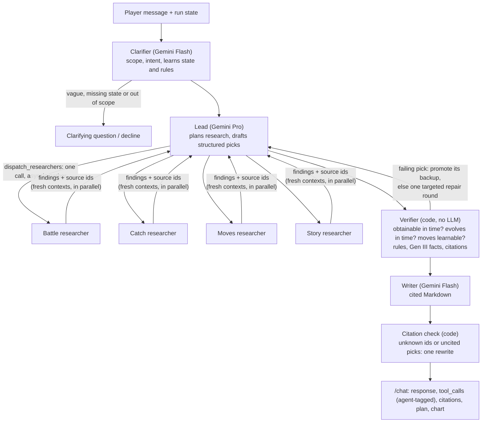
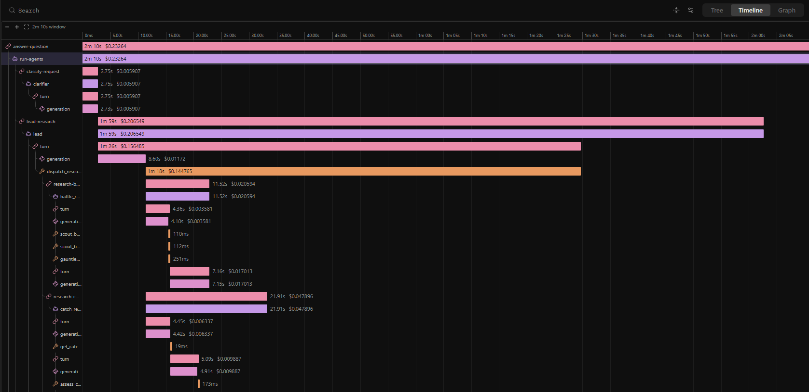
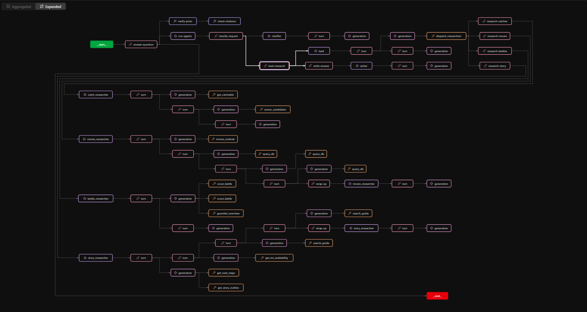

# LockeSmith

**A deep research agent for Pokémon Emerald, Ruby, Sapphire, FireRed and LeafGreen runs.** Tell it which game you're playing and where you are, and it researches what to catch next, what to do next, or how to get through the rest of the game. It checks every recommendation against that game's own data and cites it.

**Live:** https://lockesmith-816944548222.us-east4.run.app (Columbia accounts, through IAP) · **Course:** IEOR E4570 Agentic AI, Project 2, Deep Research path

## Who it's for

Players partway through Emerald, Ruby, Sapphire, FireRed or LeafGreen (the Game Boy Advance games), especially challenge runs:
- **Normal runs:** "What should I catch to get through Tate & Liza?"
- **Nuzlocke and custom rules:** one encounter per area, dupes clause, level caps, single-type runs, no legendaries, or any rule you type in plain words.
- **Randomized runs:** upload your Universal Pokémon Randomizer ZX spoiler log, and every answer uses *your* game's teams, encounters, TMs and evolutions.

Base models know Pokémon broadly and get the specifics wrong:
- The games differ more than they look:
  - Emerald's eighth gym leader is Juan; Ruby/Sapphire's is Wallace, whose Champion is Steven.
  - Every gym team differs between the games.
  - Ruby fights only Team Magma, Sapphire only Team Aqua.
  - In Ruby/Sapphire, Groudon or Kyogre is a required Lv45 battle before the eighth gym.
  - FireRed/LeafGreen cancel every evolution past #151 (Crobat, Steelix, Kingdra, Blissey, ...) until the postgame National Dex, and their wild Pokémon differ by version.
- Gen III decides physical vs special by a move's *type*, so Crunch is special and Sharpedo's 120 Attack can't use its own STAB.
- There's no Fairy type.
- Exact encounter tables, which areas a Nuzlocke has left, and anything in a randomized game.

LockeSmith answers from the data instead.

## How to use it

1. Open the site. Pick your **Game**, then fill in **Your run** on the left (starter and badges are required; party, rival, rules and a randomizer log are optional), or click one of the **Example** bubbles under the question box (hover one to see what it asks). One click fills in both the question and the run it needs. **What is this?** on the banner opens a short explainer.
2. Press **Ask**. Live progress shows each researcher working in its own lane. A catch plan takes about a minute and a half.
3. Read the answer:
   - pick cards (core vs. for-this-fight, where, when, backups)
   - the cited write-up, with `[n]` linking to its source
   - a type-coverage chart against every remaining major battle
   - the **research trace**: each round, the researchers side by side, and what the Verifier checked and changed
4. Follow up in the same conversation: "different picks, please", "I just beat Juan", "no Water types". The run panel updates with what the agent learned.

## Architecture



| Agent | Model | Job |
|---|---|---|
| Clarifier | Gemini 3.5 Flash | Gatekeeper. Declines out-of-scope questions, asks for missing starter or badges, classifies intent (catch, next steps, long plan, lookup, revision), and pulls state and rules out of the message ("I'm doing a Water monotype", "I'm playing Sapphire"). |
| Lead | Gemini 3.1 Pro | Plans the research. Sends 1–4 researchers out **in one call, in parallel, each in a fresh context**, reads their findings, may run a second round for gaps, and drafts structured picks with backups and source ids. On a follow-up it starts from the findings of earlier turns (their source ids stay citable) and researches only what they leave open. |
| Researchers ×4 | Gemini 3.5 Flash | **Battle:** teams, threats, coverage across the rest of the run. **Catch:** what's obtainable before a battle under the player's rules, and long-term value. **Moves:** learnsets, TMs obtainable in time, evolution timing. **Story:** next steps, the road to the Champion, walkthrough passages. |
| Verifier | code | Checks every pick and backup against the data. A failing pick is swapped for a passing backup, or sent back to the Lead once with the errors (the gap loop, 3 rounds max). Picks that still fail are dropped with the reason shown. It also rewrites any "where to catch it" line that disagrees with the encounter tables (place, method, odds) from the data, and flags type-matchup claims that the Gen III chart and abilities contradict ("double-resists Water", "Ice Beam does 4x to Breloom", Dig as "an answer to" a Levitating Gengar), in picks, battle notes and steps, for the Writer to fix. |
| Writer | Gemini 3.5 Flash | Turns the verified draft into a cited answer; citations are then checked in code, with one retry. |

Researchers use **composite tools** (`scout_battle`, `get_catchable`, `moves_outlook`, `assess_candidates`, `gauntlet_overview`, …). Code does the arithmetic (type charts, encounter odds, story gates); the agents decide what to investigate. Every tool result carries source ids, and only ids that a tool actually returned can be cited. Design decisions and their reasons are in [docs/decisions.md](docs/decisions.md).

**Show its work:** `/chat` keeps the Project 1 response shape. Sub-agent tool calls appear in `tool_calls` with an `agent` field: `clarifier`, `lead`, `battle_researcher`, …, `verifier`. `POST /chat/stream` streams the same turn as server-sent events for the progress view.

## Data

Built offline into one database per game, `data/emerald.duckdb`, `ruby`, `sapphire`, `firered` and `leafgreen` (about 7 MB each, committed), by `uv run python build/build_db.py` (every game, or one with `--game firered`). Sources are fetched at pinned commits (`data/sources.lock.json`) by `build/fetch_sources.py`. They share one schema, and a session reads the database of its run's game.

| Source | What it gives | Version / license |
|---|---|---|
| [pret/pokeemerald](https://github.com/pret/pokeemerald) decompilation | Ground truth for Emerald: every trainer team (levels, held items, custom moves, AI), wild encounter tables and their ROM order, TM/HM and move-tutor locations with what each needs (HMs, keys, side quests), static-encounter conditions, the friendship threshold | commit `731ad5bf`; decompiled game code, used as reference data |
| [pret/pokeruby](https://github.com/pret/pokeruby) decompilation | The same for Ruby and Sapphire. It builds either game from one tree, and the build reads each version's own wild tables, script branches and `constants/version.inc` aliases (e.g. Maxie vs. Archie at Mt. Chimney). | commit `5784633c`; decompiled game code, used as reference data |
| [pret/pokefirered](https://github.com/pret/pokefirered) decompilation | The same for FireRed and LeafGreen, from one tree with pokeemerald's layout: each version's wild tables, trades and Game Corner prizes, Kanto's move tutors (Cape Brink's included), and the National Dex evolution gate | commit `ce6406d8`; decompiled game code, used as reference data |
| [PokeAPI](https://github.com/PokeAPI/pokeapi) CSVs | Species, moves, Gen III learnsets, evolutions, encounter rows, the type chart | commit `6b8db7f3`; BSD-3-Clause, data from the games |
| Bulbapedia's [Emerald](https://bulbapedia.bulbagarden.net/wiki/Walkthrough:Pok%C3%A9mon_Emerald), [Ruby and Sapphire](https://bulbapedia.bulbagarden.net/wiki/Walkthrough:Pok%C3%A9mon_Ruby_and_Sapphire) and [FireRed and LeafGreen](https://bulbapedia.bulbagarden.net/wiki/Walkthrough:Pok%C3%A9mon_FireRed_and_LeafGreen) walkthroughs | 400, 392 and 360 passages for story steps and route context, searched with BM25; passages of a version pair are tagged with the version they describe | CC BY-NC-SA 2.5, attributed in every citation |
| `data/progression.yaml`, `progression_rs.yaml` and `progression_frlg.yaml` (hand-built, checked against the decomp) | The story battles in order (32 in Emerald, 29 steps in Ruby/Sapphire, 26 in FireRed/LeafGreen), what each opens (areas, HMs, key items, encounter methods) and each game's quirks (deferred gyms, double battles, rival variants; in Ruby/Sapphire the forced legendary and the story events that gate areas) | cites the decomp and walkthrough per entry; each file's facts were checked claim by claim against the decomp (`docs/review_packet*.md`) |
| Your randomizer log (optional upload) | Randomized wild sets, trainer teams, TM and tutor moves, stats and types, evolutions, starters, statics | parsed per session into views over the vanilla tables (`agent/overlay.py`) |

**PokeAPI is corrected to Gen III where it reflects later games** (`build/gen3_corrections.py`, tested in `tests/test_gen3_facts.py`), with the decomp as ground truth:
- past types, stats and abilities
- move power, PP, accuracy and type as of Gen III, with the category taken from the type
- no Fairy type
- the 220 friendship threshold, not 160
- regional and Gen IV evolutions removed
- PokeAPI's wrong static encounters fixed (duplicated and misplaced Voltorb and Electrode in the Hoenn games)

Ruby and Sapphire need no extra Gen III rules. Their species, moves, type chart, learnsets (except event-only Deoxys) and evolutions match Emerald's, which `tests/test_rs_facts.py` checks against pokeruby. FireRed and LeafGreen add one: before the National Dex, no evolution goes past #151 (`agent/games.py` `evolution_limit`, from `evolution_scene.c`); `tests/test_frlg_facts.py` checks their databases against pokefirered. [docs/decisions.md](docs/decisions.md) ("Data findings", D13 and D16) lists what the cross-checks found.

**Loading the data.** The five databases are committed, so after `uv sync` any of them opens directly:

```bash
uv run python -c "import duckdb; print(duckdb.connect('data/emerald.duckdb', read_only=True).sql('SHOW TABLES'))"
```

The tables behind the sample answers below are `trainer_mons` (every trainer's team, with levels, items and moves), `encounters` (wild tables, with method and rate) and `type_efficacy` (the Gen III type chart); `learnsets`, `evolutions` and `tm_locations` cover moves. To rebuild everything from the pinned sources, run `uv run python build/fetch_sources.py`, then `build/build_db.py`, then `build/build_guide_corpus.py` (the walkthrough passages, rebuilt from the saved pages in `data/guide*/pages.jsonl`).

**How the story gates were checked.** What each story battle opens (areas, HMs, key items) was checked against the decomps' map scripts and engine code: claim by claim (`docs/review_packet*.md`), and for Ruby/Sapphire also by a mechanical comparison with Emerald (`uv run python -m audit`, reports in [docs/audit/](docs/audit/)). None of it was checked by playing the games in an emulator.

## Sample queries

Each sample is one click on the site: **Examples 1, 2 and 3** under the question box. Hovering one shows what it is, and clicking it fills in the question **and** the run state. All three are Emerald runs. The example list also has a Sapphire catch plan and a Ruby Nuzlocke question, whose answers and baselines are in [docs/samples/](docs/samples/) and [docs/baseline/](docs/baseline/), and a FireRed catch plan and a LeafGreen evolution question; none of them is in the table. For each sample, the table below gives:
- the **expected answer**, generated from `data/emerald.duckdb` by [`scripts/expected_answers.py`](scripts/expected_answers.py) ([docs/samples/expected.md](docs/samples/expected.md)), with the tables it comes from
- the **baseline**: Gemini 3.1 Pro with no tools and no system prompt, given the run state in words ([`scripts/baseline.py`](scripts/baseline.py)). It's the Lead's model and the strongest in the pipeline; the Clarifier, researchers and Writer run Gemini 3.5 Flash.
- **LockeSmith's answer**, from `POST /chat` ([`scripts/run_samples.py`](scripts/run_samples.py); traces in [docs/samples/](docs/samples/))

The table summarizes both answers and what was checked; each sample's full baseline and LockeSmith answers are in the collapsed sections under it.

### 1. Mid-game catch plan (vanilla)

> **Run:** Mudkip, rival May, 6 badges; party Marshtomp 33, Breloom 30, Swellow 31, Manectric 30.
> **Question:** *What should I catch to get through Tate & Liza?*

| | |
|---|---|
| **Expected** (`trainer_mons`, `type_efficacy`, `encounters` via `get_catchable`) | A **double battle** against Claydol 41, Xatu 41, Lunatone 42 and Solrock 42 (both rock/psychic ones holding Sitrus Berries). Ghost and Dark hit all four super-effectively, Water three. Obtainable before the gym: Carvanha/Sharpedo (Super Rod: Routes 118, 119, 122, …), Shuppet (Mt. Pyre 1F–3F, 100%), Absol (Route 120 grass, 8%), Staryu (Lilycove, Super Rod 15%). |
| **Baseline** ([full](docs/baseline/tate-liza.md)), 34 s, $0.03 | **Good.** Sharpedo (Super Rod in Mossdeep), Absol or Banette with TM30 Shadow Ball from Mt. Pyre, and Rain Dance from the gift Castform against Solrock's sun. It knows the team's moves, the Gen III physical/special split and that Surf spares your partner in Gen III doubles. Every specific fact I checked against the data was right. No sources. |
| **LockeSmith** ([full](docs/samples/tate-liza.md)), 77 s, $0.17 | **Sharpedo** (Super Rod on Routes 103/118/122, Lv30–35, 40%) and **Shuppet → Banette** (Mt. Pyre 1F–3F, 100%), with backups Spheal and Absol. It flags that Surf and Crunch are special in Gen III, against Sharpedo's higher Attack. Battle notes: Claydol, Lunatone and Solrock have Levitate (immune to Ground), every foe knows Psychic (2× on Breloom), and Solrock's Sunny Day + Solar Beam does 4× to Swampert. 16 cited sources plus a coverage chart for the rest of the run. |

<details>
<summary>Baseline's full answer (Gemini 3.1 Pro, no tools, no system prompt)</summary>

Tate & Liza in *Pokémon Emerald* are notoriously one of the hardest Gym battles in the entire franchise. Because it’s a Double Battle and their team covers their weaknesses perfectly, your current team is going to have a very hard time.

Before looking at what to catch, we need to address two things:
1. **You are severely underleveled.** Your team is level 30-33, but Tate & Liza’s Pokémon are **levels 41 and 42**. You need to grind to at least level 38-40.
2. **Evolve Marshtomp.** Get Marshtomp to Level 36 so it evolves into Swampert.

Here is why this gym is so hard for your current party, followed by the best Pokémon you can catch right now to beat them.

**Why Your Current Team is in Danger**
*   **Breloom** will be absolutely destroyed here. All four of their Pokémon have Psychic moves. Breloom is dead weight for this fight.
*   **Marshtomp/Swampert** is great, but Solrock knows **Sunny Day** and **SolarBeam**. Because of Swampert's 4x weakness to Grass, one SolarBeam will instantly knock it out.
*   **Manectric** is frail, and their lead Pokémon (Claydol) is a Ground-type immune to Electric moves and will use Earthquake to one-shot Manectric.

**What to Catch**
To beat Tate & Liza, you need **Dark-types** (immune to Psychic) and Pokémon that can abuse **Surf** (which hits both opponents in a Double Battle).

**1. Carvanha / Sharpedo (The Glass Cannon MVP)**
*   **Why:** It is Water/Dark. It is completely immune to their Psychic attacks, and its Water-typing resists Solrock's Flamethrower. Teach it **Surf** and it will deal massive damage to Claydol, Solrock, and Lunatone simultaneously. It also gets Crunch to deal with Xatu.
*   **Where to get it:** You can fish with a Good Rod on Route 118 or 119 to get Carvanha, or wait until you get to Mossdeep City, grab the Super Rod, and fish right in the city to catch a high-level Sharpedo directly.

**2. Absol (The Physical Sweeper)**
*   **Why:** Absol is a pure Dark-type, meaning it takes 0 damage from Psychic attacks. In Generation 3, Ghost-type moves are Physical, and Absol has a massive Physical Attack stat. Teach it **Shadow Ball** (TM30, found inside Mt. Pyre) and it will one-shot or two-shot almost everything in this gym.
*   **Where to get it:** Route 120 (in the tall grass). It has a low encounter rate (around 8%), but it is entirely worth the hunt.

**3. Shuppet / Banette (The Ghost Hitter)**
*   **Why:** If you don't want to hunt for Absol, Banette is an excellent alternative. It has incredibly high Physical Attack. Slap the **Shadow Ball** TM on it, and it will tear through Xatu, Lunatone, and Solrock.
*   **Where to get it:** Mt. Pyre (you have to go here for the story anyway before facing the Gym).

**The Secret Weapon (Already in your PC!)**
**Castform**
You were given Castform at the Weather Institute. You should strongly consider bringing it into this fight for one reason: **Rain Dance**.
Tate & Liza's ultimate strategy is to have Xatu or Solrock use Sunny Day, which allows Solrock to fire off SolarBeams with no charge turn to kill your Swampert. If you have Castform (or any fast Pokémon) use Rain Dance, the sun goes away. Solrock will now have to waste a turn charging SolarBeam, making it virtually useless, and Swampert's/Sharpedo's Surf attacks will get a massive 50% damage boost from the rain.

**Recommended Strategy**
Go into the battle with **Swampert** and **Sharpedo** (or Absol) as your leads.
Turn 1, have Swampert use Surf (Surf doesn't hurt your own teammate in Gen 3!) and have your Dark-type focus entirely on taking down Claydol or Xatu. Keep Swampert away from Solrock unless you have changed the weather to Rain!

</details>

<details>
<summary>LockeSmith's full answer, with its sources</summary>

Catch a Sharpedo or Shuppet to exploit Tate & Liza's type weaknesses, and level up Marshtomp to evolve into Swampert [1].

**Top picks**
**Sharpedo (core)**
* **Where:** Route 103, 118, or 122 [2][3]
* **When:** Right now, using the Super Rod [2][3] (at Lv30-35) [2][3].
* **Why it helps now:** Its Dark/Water typing grants it complete immunity to Tate & Liza's Psychic attacks [4]. With STAB Surf and Crunch, it can hit their entire team for super-effective damage [5]. *Note: In Gen III, Water and Dark are both special types, whereas Sharpedo has a massive 120 Attack and a lower 95 Sp. Atk.*
* **Long run:** A potent glass cannon [4]. Its high offenses are very useful against Elite Four Phoebe's Ghost types [4].
* **Backup:** **Spheal** (found walking in Shoal Cave B1F/B2F at Lv26-32 [6]). It evolves into Sealeo at Level 32 [7]. It has great bulk to survive hits, and Surf deals super-effective damage to Claydol, Solrock, and Lunatone [8]. In the long term, it evolves into Walrein at 44, offering S-tier value and acting as the ultimate counter to Elite Four Drake [8].

**Shuppet (for this fight)**
* **Where:** Mt. Pyre 1F-3F [9] (walking at Lv22-29) [9].
* **When:** Right now, at Mt. Pyre [9].
* **Why it helps now:** It evolves into Banette at Level 37 [10]. Ghost-type moves are physical in Gen III, so Banette's massive 115 Attack allows physical Shadow Ball to completely shred the relatively fragile physical defenses of Tate & Liza's team [11].
* **Long run:** Great offensive asset against Elite Four Phoebe, but its low Speed and defensive stats make it risky in later boss fights [11].
* **Backup:** **Absol** (found walking on Route 120 at Lv25-27 [12]). It boasts a colossal 130 base Attack [13]. By teaching it Shadow Ball (TM30), it can bypass its Special Dark typing and crush the Mossdeep Gym leaders with physical Ghost damage [13]. It is a strong physical attacker, but relies on TM support since Dark-type moves run off its lower 75 Sp. Attack [13].

---

**Key Battles**
**Gym 7: Tate & Liza**
Tate & Liza use Claydol, Xatu, Lunatone, and Solrock (up to Level 42) [14][15]. Claydol, Lunatone, and Solrock all have the Levitate ability, making them completely immune to Ground-type attacks [16]. Every Pokémon on their team knows Psychic, which hits Breloom for 2x super-effective damage [14][15]. Solrock also carries Sunny Day and Solar Beam, threatening Marshtomp/Swampert with a 4x super-effective Grass-type attack [15].

Your Marshtomp is currently Level 33, while Tate & Liza's team reaches Level 42 [15]. Marshtomp evolves into Swampert at Level 36 [1], gaining crucial stats to survive, so make sure to level it up before tackling this gym.

---

**Assumptions**
* You have access to the Super Rod.
* You still have the TM for Shadow Ball (TM30) if you choose to use Shuppet/Banette or Absol.

**To sharpen this**
* Have you already used TM30 (Shadow Ball)?
* Are you planning to complete the optional Lilycove City rival battle to unlock the Department Store TMs?

**Not covered**
* Any specific items or party composition beyond the recommended captures.

**Sources**
1. PokeAPI: Marshtomp evolves into Swampert (`pokeapi:pokemon_evolution#135`)
2. PokeAPI: Sharpedo at Route 103 (super-rod) (`pokeapi:encounters#29611`)
3. PokeAPI: Carvanha at Route 118 (super-rod) (`pokeapi:encounters#29835`)
4. PokeAPI: Sharpedo (species data) (`pokeapi:pokemon_species#319`)
5. PokeAPI: Sharpedo learns Crunch (level-up) (`pokeapi:pokemon_moves#319/242/level-up/22`)
6. PokeAPI: Spheal at Shoal Cave (walk) (`pokeapi:encounters#70736`)
7. PokeAPI: Sealeo evolves into Walrein (`pokeapi:pokemon_evolution#185`)
8. PokeAPI: Walrein (species data) (`pokeapi:pokemon_species#365`)
9. PokeAPI: Shuppet at Mt. Pyre (walk) (`pokeapi:encounters#29953`)
10. PokeAPI: Shuppet evolves into Banette (`pokeapi:pokemon_evolution#180`)
11. PokeAPI: Banette (species data) (`pokeapi:pokemon_species#354`)
12. PokeAPI: Absol at Route 120 (walk) (`pokeapi:encounters#30560`)
13. PokeAPI: Absol (species data) (`pokeapi:pokemon_species#359`)
14. pokeemerald src/data/trainer_parties.h (sParty_TateAndLiza1/1) (`decomp:trainer_parties.h#sParty_TateAndLiza1/1`)
15. pokeemerald src/data/trainer_parties.h (sParty_TateAndLiza1/4) (`decomp:trainer_parties.h#sParty_TateAndLiza1/4`)
16. database query a5bbcba1f9 (`sql:a5bbcba1f9`)

</details>

### 2. Nuzlocke into Juan

> **Run:** 7 badges; party Swampert 42, Breloom 40, Swellow 40, Manectric 39; **Nuzlocke, dupes clause, level caps**, with 23 areas already used.
> **Question:** *Nuzlocke with the dupes clause and level caps. Juan is next; what should I catch?*

| | |
|---|---|
| **Expected** (`trainer_mons` for Juan's team and so the level cap, `type_efficacy`, `encounters` via `get_catchable` with the used areas removed) | Juan: Luvdisc 41, Whiscash 41, Sealeo 43, Crawdaunt 43, **Kingdra 46** (Water Pulse, Double Team, Ice Beam, Rest; Chesto Berry). That makes the **level cap 46**. Grass hits 4 of 5 super-effectively, Electric 3. Still catchable in unused areas: Magnemite/Voltorb (New Mauville, 50%), Chinchou (Route 124 seaweed, 30%), Oddish (Route 123), Lileep (fossil gift). |
| **Baseline** ([full](docs/baseline/nuzlocke-juan.md)), 54 s, $0.06 | Reasonable picks (Magneton, Walrein, Lanturn, Starmie), all from areas not yet used, and Kingdra's moves and TM34 Shock Wave are right. But **three claims are wrong**: Magneton learns Lock-On at **Lv35**, not 33; it doesn't learn **Swift** by level-up (its Lv44 move is Tri Attack); and the tip to hold a **Cheri Berry** against Water Pulse's confusion names the wrong berry (Cheri cures paralysis). The first two are in LockeSmith's data; berry effects aren't. |
| **LockeSmith** ([full](docs/samples/nuzlocke-juan.md)), 71 s, $0.19 | **Spheal → Walrein** (Shoal Cave, 50%) and **Staryu → Starmie** (Lilycove, Super Rod, 15%; needs a Water Stone), with **Chinchou → Lanturn** (Route 124/126 seaweed, 30%) as the backup. Each place was checked against the 23 used areas, the dupes clause and the level cap of 46. It warns that Kingdra's Ice Beam threatens Breloom and Swellow and Whiscash's Earthquake threatens Manectric, and points to the Ice Beam and Thunderbolt TMs at the Mauville Game Corner. A "Rules I followed" section lists what the Verifier checked. One omission: the Lilycove Department Store TMs it also mentions need the Lilycove rival battle first. |

<details>
<summary>Baseline's full answer (Gemini 3.1 Pro, no tools, no system prompt)</summary>

With 7 badges down, your level cap for Juan is **Level 46** (his ace is Kingdra).

Looking at your current team, **Manectric** and **Breloom** match up incredibly well against 4 of Juan's 5 Pokémon. Breloom will absolutely destroy Whiscash (which has a 4x weakness to Grass and no Ice moves), and Manectric can sweep Luvdisc, Sealeo, and Crawdaunt with Thunderbolt.

However, Juan’s ace—**Kingdra**—is a notorious run-killer. It has Water Pulse, Ice Beam, Rest (with a Chesto Berry), and Double Team. Because it is his final Pokémon, you cannot use Roar or Whirlwind to phase away its Double Team boosts.

Looking at your list of used areas, you have left some of the best locations in the game untouched. Here is exactly what you should go catch to counter Kingdra and build your team for the Elite Four:

**1. The Ultimate Kingdra Counter: Magneton**
**Location:** New Mauville (Surf from Route 110)
**Encounter:** Magnemite / Voltorb (If you get Voltorb, Electrode is still great, but Magneton is the prize).
*   **Why it's perfect:** Magneton is Electric/Steel. Steel resists Kingdra’s Ice Beam, and Electric takes neutral damage from Water Pulse. More importantly, Magneton learns **Lock-On** (Lv 33) and **Swift** (Lv 44) natively.
*   **The Strategy:** You can either use Lock-On followed by Thunderbolt to guarantee a hit through 6 Double Teams, or teach it **Shock Wave** (TM34 from Wattson), which is a "never-miss" Electric move. Magneton completely walls Kingdra and slowly whittles it down without missing.

**2. The Unkillable Tank: Spheal (Walrein)**
**Location:** Shoal Cave (Route 125, north of Mossdeep)
**Encounter:** Spheal / Sealeo (or Snorunt, but Spheal is most common)
*   **Why it's perfect:** If you evolve Spheal into Walrein (Lv 44), you get a massive Water/Ice tank with the ability Thick Fat. It resists Water Pulse and takes 1/4 damage from Ice Beam.
*   **The Strategy:** Walrein is your ultimate safe switch. It can soak up Kingdra's hits indefinitely, heal up, and use Body Slam to fish for Paralysis, effectively neutralizing Kingdra's speed and Double Team evasion advantage. (Walrein is also basically mandatory to easily beat Drake in the Elite Four).

**3. The Perfect Pivot: Chinchou (Lanturn)**
**Location:** Underwater (Dive on Route 124 or 126)
**Encounter:** Chinchou / Clamperl / Relicanth
*   **Why it's perfect:** Lanturn (evolves at Lv 27) is Water/Electric. It resists both of Kingdra's attacking moves (Water and Ice).
*   **The Strategy:** Like Magneton, you can teach it Shock Wave (TM34) to bypass Double Team. It has a massive HP pool and can comfortably sit in front of Kingdra all day while hitting it with STAB Electric moves.

**4. The Fast Sweeper: Staryu (Starmie)**
**Location:** Lilycove City (Fish with the Super Rod)
**Encounter:** Staryu (15% chance, repels + level manipulation can help depending on dupes)
*   **Why it's perfect:** Starmie is blazing fast and has fantastic Special Attack. It resists Water and Ice.
*   **The Strategy:** You can teach it Thunderbolt (Game Corner TM), Ice Beam (Abandoned Ship TM), Recover, and either Swift or Shock Wave. It can outspeed and out-damage almost anything Juan throws at you.

---

**How to route the Gym Fight:**
1. **Lead with Manectric:** OHKO his **Luvdisc** with Thunderbolt.
2. **Switch to Breloom on Whiscash:** Whiscash will likely try to set up Rain Dance or Amnesia. Breloom is faster and will OHKO it with Giga Drain (TM19 from Route 123) or chunk it massively with Sky Uppercut/Mach Punch.
3. **Bring Manectric back out:** Thunderbolt will OHKO or 2HKO **Sealeo** and **Crawdaunt**. (If Manectric gets low, Swampert and Breloom can help clean these two up).
4. **The Kingdra Finale:** Switch into your new **Magneton** or **Lanturn**. Spam **Shock Wave** (TM34). Because Shock Wave never misses, Double Team is completely useless. Let Kingdra use Rest to consume its Chesto Berry, then keep spamming Shock Wave until it goes down.

**Pro Nuzlocke Tip:** Give your Kingdra counter a **Cheri Berry** to hold. Kingdra's Water Pulse has a 20% chance to confuse, which is the only way it can reliably break your strategy if it gets lucky. Removing that RNG makes this fight a guaranteed win.

</details>

<details>
<summary>LockeSmith's full answer, with its sources</summary>

Spheal and Staryu are excellent additions to handle Juan and the Elite Four, rounding out your team's coverage [1][2].

**Top picks**
**Spheal (Walrein) — Core [1][3]**
* **Where:** Shoal Cave (B1F, B2F, or High-Tide), walking, Levels 26-32 (50% encounter rate) [1][4].
* **When:** Available right now, before facing the Mossdeep Space Center or Juan [1].
* **Why it helps now:** Juan's Kingdra is a notorious run-killer with Double Team, Rest, and Ice Beam [5]. Walrein's massive bulk and Thick Fat ability let it easily tank Ice Beam and Water Pulse, allowing it to sit in against Kingdra and hit back with Ice-type attacks [5].
* **Long run:** Walrein is one of the best Elite Four Pokémon in Hoenn [3]. Its Ice-type STAB is critical for defeating Drake's Dragon-types, and its durability makes it excellent against Wallace [3].
* **Backup:** Chinchou (Lanturn) [6][7] (Route 124 or 126 Underwater, seaweed, 30% encounter rate [8]).

**Staryu (Starmie) — Core [2][9]**
* **Where:** Lilycove City, Super Rod, Levels 25-30 (15% encounter rate) [2].
* **When:** Available right now in Lilycove City [2].
* **Why it helps now:** Starmie is a premier fast attacker [9]. With access to Thunderbolt and Ice Beam via TMs, it can effortlessly sweep the rest of Juan's team (Luvdisc, Sealeo, Crawdaunt) before you have to face Kingdra [5][10].
* **Long run:** Starmie's unmatched coverage (Surf, Thunderbolt, Ice Beam, Psychic) and high Speed make it a top-tier sweeper for the entire Elite Four [9].
* **Backup:** Chinchou (Lanturn) [6][7] (Route 124 or 126 Underwater, seaweed, 30% encounter rate [8]).

*Note: Starmie requires a Water Stone to evolve [9]. Make sure you have one available before challenging Juan.*

---

**Key Battles**
**Gym 8: Juan**
* **Watch out for:** Juan's Kingdra (Lv46) has Double Team, Rest (holding a Chesto Berry), Water Pulse, and Ice Beam [5]. It threatens Breloom and Swellow with super-effective Ice-type damage [11][5].
* **Ground Caution:** Be careful with Manectric, as Juan's Whiscash knows Earthquake [12].

---

**Key Steps**
1. **Check your Level Cap:** Juan's highest-level Pokémon is his Kingdra at Level 46 [5]. Ensure your team stays at or below this level limit [13].
2. **Equip Key TMs:** Purchase TM13 Ice Beam and TM24 Thunderbolt from the Mauville Game Corner for your new catches, or pick up TM25 Thunder and TM14 Blizzard from the Lilycove Department Store [14][15][10][16].

---

**Assumptions**
* You have the Super Rod needed to fish for Staryu.
* You have access to a Water Stone to evolve Staryu.

**To sharpen this**
* Do you already have a Water Stone for Staryu, or need to know where to find one?

**Rules I followed**
- Nuzlocke: first encounter per named location only, dupes clause; gifts, statics and trades are free (checked by the Verifier)
- encounters already used: Route 101, Route 102, Route 103, Route 104, Petalburg Woods, Route 116, Rusturf Tunnel, Granite Cave, Route 110, Route 117, Route 111, Route 112, Fiery Path, Route 113, Route 114, Meteor Falls, Route 115, Route 118, Route 119, Route 120, Route 121, Safari Zone, Mt. Pyre (checked by the Verifier)
- level caps: stay at or below the next boss's highest level (checked by the Verifier)

**Sources**
1. PokeAPI: Spheal at Shoal Cave (walk) (`pokeapi:encounters#70736`)
2. PokeAPI: Staryu at Lilycove City (super-rod) (`pokeapi:encounters#30913`)
3. PokeAPI: Sealeo evolves into Walrein (`pokeapi:pokemon_evolution#185`)
4. PokeAPI: Spheal at Shoal Cave (walk) (`pokeapi:encounters#70808`)
5. pokeemerald src/data/trainer_parties.h (sParty_Juan1/5) (`decomp:trainer_parties.h#sParty_Juan1/5`)
6. PokeAPI: Chinchou evolves into Lanturn (`pokeapi:pokemon_evolution#95`)
7. PokeAPI: Lanturn (species data) (`pokeapi:pokemon_species#171`)
8. PokeAPI: Chinchou at Route 124 (seaweed) (`pokeapi:encounters#29872`)
9. PokeAPI: Staryu evolves into Starmie (`pokeapi:pokemon_evolution#70`)
10. pokeemerald data/maps/MauvilleCity_GameCorner (TM13) (`decomp:data/maps/MauvilleCity_GameCorner#TM13`)
11. Gen 3 type chart (pokeemerald gTypeEffectiveness) (`rules:gen3_type_chart`)
12. pokeemerald src/data/trainer_parties.h (sParty_Juan1/2) (`decomp:trainer_parties.h#sParty_Juan1/2`)
13. database query ef2ed14180 (`sql:ef2ed14180`)
14. pokeemerald data/maps/LilycoveCity_DepartmentStore_4F (TM25) (`decomp:data/maps/LilycoveCity_DepartmentStore_4F#TM25`)
15. pokeemerald data/maps/LilycoveCity_DepartmentStore_4F (TM14) (`decomp:data/maps/LilycoveCity_DepartmentStore_4F#TM14`)
16. pokeemerald data/maps/MauvilleCity_GameCorner (TM24) (`decomp:data/maps/MauvilleCity_GameCorner#TM24`)

</details>

### 3. Randomized gym

> **Run:** as in sample 1, plus the uploaded **sample randomizer log** ([static/samples/fire-tate-liza.log](static/samples/fire-tate-liza.log)), in which Tate & Liza use Fire types.
> **Question:** *What should I catch to get through Tate & Liza?*

| | |
|---|---|
| **Expected** (the log, read into a session view of `trainer_mons`; `type_efficacy`; `encounters` via `get_catchable`) | Camerupt 41, Torkoal 41, Magcargo 42 and Houndoom 42 (Sitrus Berries on the last two). Water and Ground hit all four super-effectively. Wild Pokémon are vanilla in this log: Carvanha/Sharpedo, Barboach (Super Rod: Routes 111, 114, 120), Spheal and others. |
| **Baseline** ([full](docs/baseline/randomizer-tate-liza.md)), 52 s, $0.05 | **Good here, because the sample log is short enough to paste into the prompt.** A "double Surf" with Swampert plus Starmie, Tentacruel or Gyarados/Pelipper, with the right type math (Camerupt and Magcargo are 4× weak to Water). **Two claims the data contradicts:** TM26 Earthquake is in Seafloor Cavern, which needs Dive and so opens only after this gym, and wild Tentacruel live only at the Abandoned Ship, not "almost any ocean route". A real UPR log covers all 855 trainers and every wild table; LockeSmith's full-size test log for Emerald is 6,000 lines before movesets and stats, far too much to paste usefully into a chat. |
| **LockeSmith** ([full](docs/samples/randomizer-tate-liza.md)), 82 s, $0.20 | It reads the team from the log (cited as "Your randomizer log: Leader Tate&Liza's team"), with the level-up moves UPR gives randomized trainers (Camerupt's Earthquake and Rock Slide), and recommends **Spheal** (Shoal Cave, 50%) and **Sharpedo** (Super Rod, Routes 103/118, 40%), with Shuppet as Sharpedo's backup. The Verifier rewrote Sharpedo's "where" line from the encounter data and flagged that Surf is special for Sharpedo. **Two weak spots:** Spheal's backup, Aron, is caught at Lv9–12 and is 4× weak to the Earthquake the answer itself warns about, and it says Swampert learns Muddy Water at Lv37 (that's Marshtomp's level; Swampert's is 39). The Verifier checks that picks can be caught and their moves learned in time; it doesn't judge whether a backup suits the fight, or check learn levels in advice about the player's own party. |

<details>
<summary>Baseline's full answer (Gemini 3.1 Pro, no tools, no system prompt)</summary>

This is a huge stroke of luck for you! By randomizing Tate and Liza to Fire-types, you've completely bypassed the notorious difficulty of their vanilla Psychic-type gym. Since the rest of your game's wild encounters are vanilla, you have access to some incredibly powerful tools to sweep them.

However, you have one major problem to address first: **Your levels.** Tate and Liza's team is Level 41–42, and your highest is 33. You will need to grind a bit, but with the right catches, you won't need to match their levels perfectly.

Here is exactly what you should catch and the strategy you should use to wash them away.

**The Strategy: "Gen 3 Surf Mechanics"**
In Generation 3 (Ruby/Sapphire/Emerald), the move **Surf** in a Double Battle is incredibly broken because **it hits both opponents, but DOES NOT hit your ally.** (This was changed in Gen 4).

Because Tate and Liza are using a full Fire-type team in a Double Battle format, **Double-Surf spam** is all you need. Furthermore, Camerupt and Magcargo are **4x weak to Water**, meaning they will be instantly deleted by almost any Surf attack.

**Priority #1: Evolve Marshtomp**
Before doing anything else, get your Marshtomp to **Level 36** so it evolves into **Swampert**. Swampert’s Water/Ground typing is virtually invincible in this gym. Give it **Surf** (HM03) and **Earthquake** (TM26, found deep in the Seafloor Cavern, or just use Mud Shot/Dig).

**Priority #2: Catch a Surf Partner**
You want a second Water-type to put right next to Swampert. Since everything else in your ROM is vanilla, you can easily grab one of these around Lilycove City or Mossdeep City:

**1. Staryu / Starmie (The Best Option)**
*   **Why:** Starmie is blazing fast and hits like a truck. Houndoom is their fastest Pokémon, and Starmie will naturally outspeed it and hit it with a super-effective Surf.
*   **Where to get it:** Use the Super Rod in the water at Lilycove City.
*   **How to evolve:** Use a Water Stone (trade a Blue Shard to the Treasure Hunter on Route 124). Give it Surf and Mystic Water.

**2. Tentacruel (The Tanky Option)**
*   **Why:** Tentacruel has massive Special Defense and naturally resists Fire-type moves. It's also quite fast. It can comfortably sit next to Swampert and spam Surf all day without taking much damage from Flamethrowers.
*   **Where to get it:** You can encounter wild Tentacruel (around Level 25-30) while surfing on almost any ocean route (Route 124, 125, etc.), or just catch a Tentacool and evolve it at Level 30.

**3. Magikarp / Gyarados OR Wingull / Pelipper (The Earthquake Option)**
*   **Why:** While Gen 3 Surf doesn't hit your ally, **Earthquake DOES hit your ally.** If you want Swampert to be able to spam Earthquake freely to deal with Torkoal and Houndoom, its partner needs to be a Flying-type or have the Levitate ability. Gyarados and Pelipper are both Water/Flying. Gyarados also provides Intimidate, which lowers Camerupt's Earthquake and Torkoal's Body Slam damage.
*   **Where to get them:** Literally everywhere there is water.

**How the Battle Will Go**
1.  **Bench Breloom:** Breloom is Grass/Fighting and will get instantly KO'd by anything on their team. Leave it in the back.
2.  **Lead Swampert + Your New Water Catch (Starmie/Tentacruel/Gyarados).**
3.  **Turn 1:** Have both of your Pokémon use **Surf**.
4.  Because Tate and Liza will lead with Camerupt and Torkoal (or Magcargo), the double-Surf will hit both of them. Camerupt will instantly faint to the 4x weakness. Torkoal will take massive damage from two consecutive Surfs.
5.  **Turn 2+:** Just keep pressing Surf. Magcargo will instantly die upon switching in (4x weakness), and Houndoom's Special Defense isn't high enough to survive Double-Surfs.

Even if you go into this fight slightly underleveled (around Level 38), the type matchups and the double-target mechanics of Surf will make this the easiest badge of your run!

</details>

<details>
<summary>LockeSmith's full answer, with its sources</summary>

Tate & Liza's randomized team is entirely Fire-type, making bulky Water-types like Spheal and Sharpedo ideal catches to pair with your Marshtomp's evolutions [1].

**Top picks**
**Spheal (core)**
* **Where to catch:** Shoal Cave (B1F, B2F, or high-tide) via walking (50% encounter rate, Levels 26-32) [2].
* **When to catch:** Immediately available after acquiring Surf to reach Shoal Cave north of Mossdeep [3].
* **Why it helps now:** Tate & Liza's randomized team consists of Camerupt, Torkoal, Magcargo, and Houndoom [1]. Spheal's Water typing allows it to exploit their heavy Fire-type composition, especially using Surf which hits both opponents in a Double Battle [4][1][3].
* **Long run:** Outstanding long-term value [4]. It evolves into Sealeo (and eventually Walrein), has massive bulk, and hits 26 remaining opponents super-effectively, making it incredibly strong against Elite Four Drake's Dragon types [4][5].
* **Backup:** Aron (found in Granite Cave B1F or B2F via walking, 40% encounter rate, Levels 9-12) [6][7]. It acts as a premier physical wall against Normal and Flying moves and evolves into Lairon and then Aggron, yielding a monumental 180 Base Defense [7][8].

**Sharpedo (core)**
* **Where to catch:** Route 103 or Route 118 by fishing with the Super Rod (Lv30-35, 40% encounter rate) [9][10].
* **When to catch:** Immediately available once you have the Super Rod [9][10].
* **Why it helps now:** Its strong offensive stats allow it to quickly sweep Tate & Liza's Fire-type team before they can retaliate [11][1]. *(Note: Surf is a Special move in Gen III, so it won't use Sharpedo's massive 120 Physical Attack, but its 95 Special Attack is still very serviceable)*.
* **Long run:** Hits 15 remaining opponents super-effectively and is excellent against Elite Four Phoebe, but its low defensive stats make it a glass cannon [11].
* **Backup:** Shuppet (found on Mt. Pyre 1F-3F, 100% encounter rate, Levels 22-29) [12][13]. It evolves into Banette, deals immense physical Ghost-type STAB damage, and is extremely useful for defeating Elite Four Phoebe [13][14].

---

**Key Battles**
**Gym Leader: Tate & Liza**
Tate & Liza have a randomized, Fire-heavy team of Camerupt (Lv41), Torkoal (Lv41), Magcargo (Lv42), and Houndoom (Lv42) [1]. Camerupt carries Earthquake and Rock Slide, which threaten Manectric and Swellow [1]. Use Water-type moves like Surf to deal heavy damage to both opponents simultaneously [15][3].

---

**Next Steps**
1. **Level up your party:** Your party is currently heavily underleveled [1]. Marshtomp is Level 33, while Tate & Liza's team is Level 41-42; you will need to level up significantly to survive [1].
2. **Evolve Marshtomp and upgrade moves:** Marshtomp evolves into Swampert at level 36 [16]. Teach it Surf (HM03) and Muddy Water (learned at level 37) to exploit the Fire-type weaknesses of the Gym Leaders' Pokémon [17][3].

---

**Assumptions**
* Your randomized seed left wild encounters and TM availability normal [18].
* You are willing to spend time grinding levels to bridge the 9-level gap before fighting Tate & Liza [1].

**To sharpen this**
* Are you willing to replace Marshtomp/Swampert or run multiple Water-types, as Spheal/Sharpedo would add type overlap to your party [4][11]?
* Do you prefer a highly defensive pivot or a fast, offensive threat for your tactical playstyle [4][11]?

**Not covered**
* We don't know the exact movesets of your party, so we can't suggest exactly which moves to replace.

**Sources**
1. Your randomizer log: Leader Tate&Liza's team (`log:trainers#271`)
2. PokeAPI: Spheal at Shoal Cave (walk) (`pokeapi:encounters#70736`)
3. pokeemerald data/maps/PetalburgCity_WallysHouse (HM03) (`decomp:data/maps/PetalburgCity_WallysHouse#HM03`)
4. PokeAPI: Spheal (species data) (`pokeapi:pokemon_species#363`)
5. PokeAPI: Walrein (species data) (`pokeapi:pokemon_species#365`)
6. PokeAPI: Aron at Granite Cave (walk) (`pokeapi:encounters#29913`)
7. PokeAPI: Aron (species data) (`pokeapi:pokemon_species#304`)
8. PokeAPI: Aggron (species data) (`pokeapi:pokemon_species#306`)
9. PokeAPI: Sharpedo at Route 103 (super-rod) (`pokeapi:encounters#29611`)
10. PokeAPI: Sharpedo at Route 118 (super-rod) (`pokeapi:encounters#29834`)
11. PokeAPI: Sharpedo (species data) (`pokeapi:pokemon_species#319`)
12. PokeAPI: Shuppet at Mt. Pyre (walk) (`pokeapi:encounters#29953`)
13. PokeAPI: Shuppet (species data) (`pokeapi:pokemon_species#353`)
14. PokeAPI: Banette (species data) (`pokeapi:pokemon_species#354`)
15. Gen 3 type chart (pokeemerald gTypeEffectiveness) (`rules:gen3_type_chart`)
16. PokeAPI: Marshtomp evolves into Swampert (`pokeapi:pokemon_evolution#135`)
17. PokeAPI: Marshtomp learns Muddy Water (level-up) (`pokeapi:pokemon_moves#259/330/level-up/37`)
18. LockeSmith's Emerald rules (agent/brief.py) (`rules:game`)

</details>

**What the comparison shows.** Gemini 3.1 Pro knows Emerald's well-known fights well, so the baseline is a strong opponent. LockeSmith adds:
- picks checked against the data and cited (the baseline's Nuzlocke and randomizer answers had four claims the data contradicts; LockeSmith's picks and places were all right, though its randomizer answer has the two weak spots above)
- challenge rules applied by code, not trust
- randomized games at real-log scale
- a whole-run view (the coverage chart and "long run" notes)

It costs about 3–5× as much ($0.17–0.20 vs $0.03–0.06 per question) and takes 71–82 s against 34–54 s. These are the runs of Nov 16, with the code as submitted.

**How these answers got here.** Earlier runs of the same samples turned up errors in LockeSmith's own answers:
- a Good Rod rate given as the Super Rod's
- a "4× weak" that was 2×
- Lanturn "double-resisting" Water
- a Voltorb location that only has Electrode

Each became a new code check: `correct_places` rewrites wrong "where" lines from the encounter data, and `TYPE_CLAIM_WRONG` catches matchup claims the type chart contradicts. Details are in [docs/decisions.md](docs/decisions.md) D11–D12 and D14.

## What it can't answer

It says so instead of guessing:
- **Other games, ROM hacks and the postgame.** This includes Red/Blue/Yellow, the 3DS remakes Omega Ruby and Alpha Sapphire, Let's Go, the Battle Frontier, the Battle Tower and FireRed/LeafGreen's Sevii Islands 4-7. "What's the best EV spread for Garchomp in Sword?" is declined, with what it does cover ([saved answer](docs/samples/out-of-scope.md)).
- **Exact damage.** Matchups use the type chart and levels, not the damage formula, so "does X one-shot Y?" can only get a type-and-level answer.
- **Randomizer data it can't read yet.** If a log randomized level-up movesets, TM compatibility or move data, those tools refuse rather than answer from the vanilla game, the Verifier marks the affected moves as unverifiable, and the answer says what's unknown. Its parser follows UPR ZX's source code. **No real log has been through it**, because no ROM was available to make one. Instead, the tests write a full-size log for each of the five games in UPR's format (every wild set, every trainer, all 50 TMs) and check that the parser reads every line back exactly ([`tests/test_full_logs.py`](tests/test_full_logs.py), [D19](docs/decisions.md)). The site's sample log is hand-made in the same format.
- **Logs from other games or from modified ROMs.** A log's footer says which ROM it was made from. A log from a game it doesn't cover is turned away. If the ROM's checksum shows it was modified before randomizing (a ROM hack or a patch), or it isn't an English ROM, the page says so and the agent is told.
- **Vague questions without a run.** "What should I catch?" with no starter or badges gets a question back, not a guess ([saved answer](docs/samples/vague.md)).

## Tracing and cost

Each answer's trace panel shows the model calls, tokens and cost for that question, from `agent/pricing.py`: Vertex AI list prices read from Google's pricing page on 2026-11-01. Per sample question:

| | LockeSmith | Baseline (Gemini 3.1 Pro, no tools) |
|---|---|---|
| Time | 71–82 s | 34–54 s |
| Model calls | 14–16 (Clarifier, Lead ×2, 3 researchers ×2–5, Writer) | 1 |
| Tokens | 55k–73k | 3k–6k |
| Cost | $0.17–0.20 | $0.03–0.06 |

With LangFuse keys set (see [docs/deploy.md](docs/deploy.md)), every `/chat` turn is also a LangFuse trace (`agent/observability.py`, through OpenInference's OpenAI Agents SDK instrumentation; nothing is sent to OpenAI). Each trace is grouped by session and tagged `vanilla`/`randomized`, `nuzlocke` or `custom-rules`:

```
answer-question                   input: the question · output: the answer · metadata: intent, picks, cost, rules
├─ run-agents
│  ├─ classify-request › clarifier › generation
│  ├─ lead-research › lead › generation, dispatch_researchers (tool)
│  │     ├─ research-battles › battle_researcher › generation, scout_battle, gauntlet_overview …
│  │     ├─ research-catches › catch_researcher › generation, get_catchable, assess_candidates …   (in parallel)
│  │     └─ research-moves   › moves_researcher › generation, moves_outlook, get_tm_availability …
│  └─ write-answer › writer › generation
├─ verify-picks · correct-places · check-citations   (evaluators: the Verifier, in code)
└─ promote-backups                                    (when a backup replaced a failing pick)
```

Every generation carries its model, token usage and cost. The prices are registered in LangFuse by `scripts/langfuse_prices.py` from `agent/pricing.py`.

**One real question on the deployed site**, *"what should I try and catch next with my Nuzlocke rules?"* (production environment, tagged `vanilla`, `nuzlocke`):



*Timeline.* The whole turn took 2 min 10 s and cost $0.23 across 19 model calls. The Clarifier took 2.8 s. The Lead's `dispatch_researchers` ran four researchers at once; three finished in 11.5–21.9 s, but the round took 78 s because one of the story researcher's model calls stalled for 68 s. Its other calls took 2–3 s. That trace is why every model call now has a time limit (25 s for Flash, 60 s for Pro), after which it goes to the fallback model ([D12](docs/decisions.md)). A Flash call still unanswered after 12 s is also sent to the fallback model, and the first answer wins ([D15](docs/decisions.md)).



*Agent graph* of the same trace, expanded:
- `answer-question` → `run-agents` → `classify-request` → `lead-research`
- the Lead fans out to `research-catches`, `research-moves`, `research-battles` and `research-story`, each with its own turns and tools
- then `write-answer`
- the Verifier's `verify-picks` and `check-citations` run in code alongside
- two researchers that used up their tool budget show their `wrap-up` turn

## Running it locally

```bash
uv sync
gcloud auth application-default login   # Gemini on Vertex AI (project "lockesmith", location "global")
uv run uvicorn app:app --reload         # http://127.0.0.1:8000
uv run pytest                           # 533 tests, no model calls (5 wait for a real randomizer log; 8 need build/fetch_sources.py run first)
```

Scripts:
- `scripts/run_samples.py`: the agent on the README samples (or any example by id), saving full traces to `docs/samples/`
- `scripts/baseline.py`: the no-tools baseline, saved to `docs/baseline/`
- `scripts/expected_answers.py`: expected answers from the data
- `uv run python -m audit`: the Ruby/Sapphire vs Emerald comparison behind the review packet's section 12, run on the full decomps at their pinned commits, with reports written to `docs/audit/` ([audit/README.md](audit/README.md))

Deployment (Cloud Run, continuous deploy from GitHub, IAP, Vertex AI permissions, LangFuse) is in [docs/deploy.md](docs/deploy.md). [docs/README.md](docs/README.md) lists everything else in `docs/`.

## Credits

Built by kc3936 for IEOR E4570, with Claude Code. Pokémon and Pokémon Emerald, Ruby, Sapphire, FireRed and LeafGreen are © Nintendo, Game Freak and Creatures. This is a non-commercial course project. Walkthrough text is from Bulbapedia (CC BY-NC-SA 2.5); species and move data are from PokeAPI; game data is from the pret/pokeemerald, pret/pokeruby and pret/pokefirered decompilations.
