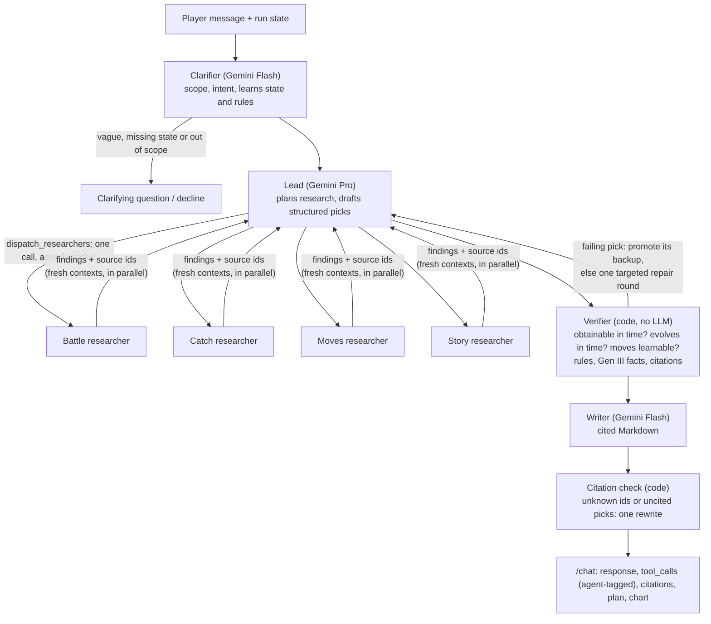
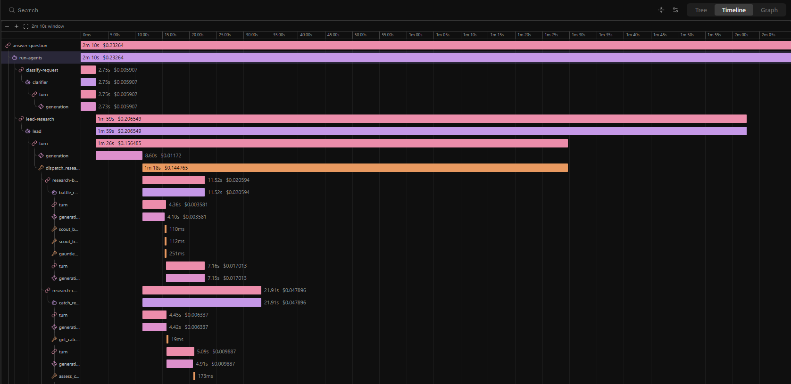
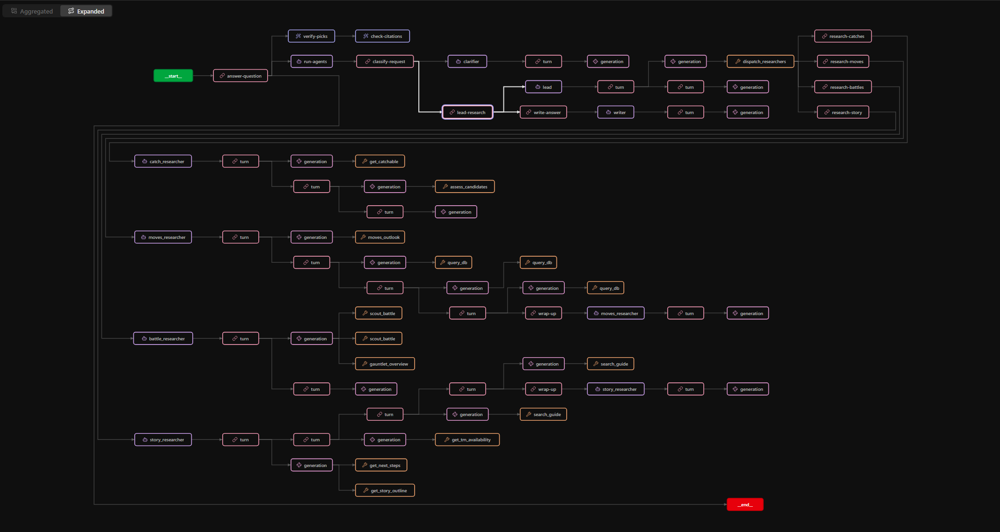

# LockeSmith

**A deep research agent for Pokémon Emerald, Ruby, Sapphire, FireRed and LeafGreen runs.** Tell it which game you're playing and where you are, and it researches what to catch next, what to do next, or how to get through the rest of the game. It checks every recommendation against that game's own data and cites it.

**Live:** https://lockesmith-816944548222.us-east4.run.app (Columbia accounts, through IAP) · **Course:** IEOR E4570 Agentic AI, Project 2, Deep Research path

## Who it's for

Players partway through Emerald, Ruby, Sapphire, FireRed or LeafGreen (the Game Boy Advance games), especially challenge runs:
- **Normal runs:** "What should I catch to get through Tate & Liza?"
- **Nuzlocke and custom rules:** one encounter per area, dupes clause, level caps, single-type runs, no legendaries, or any rule you type in plain words.
- **Randomized runs:** upload your Universal Pokémon Randomizer ZX spoiler log, and every answer uses *your* game's teams, encounters, TMs and evolutions.

Base models know Pokémon broadly and get the specifics wrong:
- The games differ more than they look:
  - Emerald's eighth gym leader is Juan; Ruby/Sapphire's is Wallace, whose Champion is Steven.
  - Every gym team differs between the games.
  - Ruby fights only Team Magma, Sapphire only Team Aqua.
  - In Ruby/Sapphire, Groudon or Kyogre is a required Lv45 battle before the eighth gym.
  - FireRed/LeafGreen cancel every evolution past #151 (Crobat, Steelix, Kingdra, Blissey, ...) until the postgame National Dex, and their wild Pokémon differ by version.
- Gen III decides physical vs special by a move's *type*, so Crunch is special and Sharpedo's 120 Attack can't use its own STAB.
- There's no Fairy type.
- Exact encounter tables, which areas a Nuzlocke has left, and anything in a randomized game.

LockeSmith answers from the data instead.

## How to use it

1. Open the site. Pick your **Game**, then fill in **Your run** on the left (starter and badges are required; party, rival, rules and a randomizer log are optional), or click one of the **Example** bubbles under the question box (hover one to see what it asks). One click fills in both the question and the run it needs. **What is this?** on the banner opens a short explainer.
2. Press **Ask**. Live progress shows each researcher working in its own lane. A catch plan takes about a minute.
3. Read the answer:
   - pick cards (core vs. for-this-fight, where, when, backups)
   - the cited write-up, with `[n]` linking to its source
   - a type-coverage chart against every remaining major battle
   - the **research trace**: each round, the researchers side by side, and what the Verifier checked and changed
4. Follow up in the same conversation: "different picks, please", "I just beat Juan", "no Water types". The run panel updates with what the agent learned.

## Architecture



| Agent | Model | Job |
|---|---|---|
| Clarifier | Gemini 3.5 Flash | Gatekeeper. Declines out-of-scope questions, asks for missing starter or badges, classifies intent (catch, next steps, long plan, lookup, revision), and pulls state and rules out of the message ("I'm doing a Water monotype", "I'm playing Sapphire"). |
| Lead | Gemini 3.1 Pro | Plans the research. Sends 1–4 researchers out **in one call, in parallel, each in a fresh context**, reads their findings, may run a second round for gaps, and drafts structured picks with backups and source ids. |
| Researchers ×4 | Gemini 3.5 Flash | **Battle:** teams, threats, coverage across the rest of the run. **Catch:** what's obtainable before a battle under the player's rules, and long-term value. **Moves:** learnsets, TMs obtainable in time, evolution timing. **Story:** next steps, the road to the Champion, walkthrough passages. |
| Verifier | code | Checks every pick and backup against the data. A failing pick is swapped for a passing backup, or sent back to the Lead once with the errors (the gap loop, 3 rounds max). Picks that still fail are dropped with the reason shown. It also rewrites any "where to catch it" line that disagrees with the encounter tables (place, method, odds) from the data, and flags type-matchup claims that the Gen III chart and abilities contradict ("double-resists Water", "Ice Beam does 4x to Breloom"), in picks, battle notes and steps, for the Writer to fix. |
| Writer | Gemini 3.5 Flash | Turns the verified draft into a cited answer; citations are then checked in code, with one retry. |

Researchers use **composite tools** (`scout_battle`, `get_catchable`, `moves_outlook`, `assess_candidates`, `gauntlet_overview`, …). Code does the arithmetic (type charts, encounter odds, story gates); the agents decide what to investigate. Every tool result carries source ids, and only ids that a tool actually returned can be cited. Design decisions and their reasons are in [docs/decisions.md](docs/decisions.md).

**Show its work:** `/chat` keeps the Project 1 response shape. Sub-agent tool calls appear in `tool_calls` with an `agent` field: `clarifier`, `lead`, `battle_researcher`, …, `verifier`. `POST /chat/stream` streams the same turn as server-sent events for the progress view.

## Data

Built offline into one database per game, `data/emerald.duckdb`, `ruby`, `sapphire`, `firered` and `leafgreen` (about 7 MB each, committed), by `uv run python build/build_db.py` (every game, or one with `--game firered`). Sources are fetched at pinned commits (`data/sources.lock.json`) by `build/fetch_sources.py`. They share one schema, and a session reads the database of its run's game.

| Source | What it gives | Version / license |
|---|---|---|
| [pret/pokeemerald](https://github.com/pret/pokeemerald) decompilation | Ground truth for Emerald: every trainer team (levels, held items, custom moves, AI), wild encounter tables and their ROM order, TM/HM and move-tutor locations with what each needs (HMs, keys, side quests), static-encounter conditions, the friendship threshold | commit `731ad5bf`; decompiled game code, used as reference data |
| [pret/pokeruby](https://github.com/pret/pokeruby) decompilation | The same for Ruby and Sapphire. It builds either game from one tree, and the build reads each version's own wild tables, script branches and `constants/version.inc` aliases (e.g. Maxie vs. Archie at Mt. Chimney). | commit `5784633c`; decompiled game code, used as reference data |
| [pret/pokefirered](https://github.com/pret/pokefirered) decompilation | The same for FireRed and LeafGreen, from one tree with pokeemerald's layout: each version's wild tables, trades and Game Corner prizes, Kanto's move tutors (Cape Brink's included), and the National Dex evolution gate | commit `ce6406d8`; decompiled game code, used as reference data |
| [PokeAPI](https://github.com/PokeAPI/pokeapi) CSVs | Species, moves, Gen III learnsets, evolutions, encounter rows, the type chart | commit `6b8db7f3`; BSD-3-Clause, data from the games |
| Bulbapedia's [Emerald](https://bulbapedia.bulbagarden.net/wiki/Walkthrough:Pok%C3%A9mon_Emerald), [Ruby and Sapphire](https://bulbapedia.bulbagarden.net/wiki/Walkthrough:Pok%C3%A9mon_Ruby_and_Sapphire) and [FireRed and LeafGreen](https://bulbapedia.bulbagarden.net/wiki/Walkthrough:Pok%C3%A9mon_FireRed_and_LeafGreen) walkthroughs | 400, 392 and 360 passages for story steps and route context, searched with BM25; passages of a version pair are tagged with the version they describe | CC BY-NC-SA 2.5, attributed in every citation |
| `data/progression.yaml`, `progression_rs.yaml` and `progression_frlg.yaml` (hand-built, reviewed) | The story battles in order (32 in Emerald, 29 steps in Ruby/Sapphire, 26 in FireRed/LeafGreen), what each opens (areas, HMs, key items, encounter methods) and each game's quirks (deferred gyms, double battles, rival variants; in Ruby/Sapphire the forced legendary and the story events that gate areas) | cites the decomp and walkthrough per entry; the Ruby/Sapphire and FireRed/LeafGreen files went through review rounds (`docs/review_packet_rs.md`, `docs/review_packet_frlg*.md`) |
| Your randomizer log (optional upload) | Randomized wild sets, trainer teams, TM and tutor moves, stats and types, evolutions, starters, statics | parsed per session into views over the vanilla tables (`agent/overlay.py`) |

**PokeAPI is corrected to Gen III where it reflects later games** (`build/gen3_corrections.py`, tested in `tests/test_gen3_facts.py`), with the decomp as ground truth:
- past types, stats and abilities
- move power, PP, accuracy and type as of Gen III, with the category taken from the type
- no Fairy type
- the 220 friendship threshold, not 160
- regional and Gen IV evolutions removed
- PokeAPI's wrong static encounters fixed (duplicated and misplaced Voltorb and Electrode in the Hoenn games)

Ruby and Sapphire need no extra Gen III rules. Their species, moves, type chart, learnsets (except event-only Deoxys) and evolutions match Emerald's, which `tests/test_rs_facts.py` checks against pokeruby. FireRed and LeafGreen add one: before the National Dex, no evolution goes past #151 (`agent/games.py` `evolution_limit`, from `evolution_scene.c`); `tests/test_frlg_facts.py` checks their databases against pokefirered. [docs/decisions.md](docs/decisions.md) ("Data findings", D13 and D16) lists what the cross-checks found. To load the data yourself: `uv sync`, then open a database in DuckDB (`duckdb data/sapphire.duckdb`), or rebuild with the commands above (`build/build_guide_corpus.py` rebuilds the walkthrough passages).

## Sample queries

Each sample is one click on the site: **Examples 1, 2 and 3** (marked ★) under the question box. Hovering one shows what it is, and clicking it fills in the question **and** the run state. All three are Emerald runs. The example list also has a Sapphire catch plan and a Ruby Nuzlocke question, whose answers and baselines are in [docs/samples/](docs/samples/) and [docs/baseline/](docs/baseline/), and a FireRed catch plan and a LeafGreen evolution question; none of them is in the table. For each sample, the table below gives:
- the **expected answer**, generated from the database by [`scripts/expected_answers.py`](scripts/expected_answers.py) ([docs/samples/expected.md](docs/samples/expected.md))
- the **baseline**: Gemini 3.1 Pro, the Lead's model, with no tools and no system prompt, given the run state in words ([`scripts/baseline.py`](scripts/baseline.py), full answers in [docs/baseline/](docs/baseline/))
- **LockeSmith's answer** ([`scripts/run_samples.py`](scripts/run_samples.py), full answers and traces in [docs/samples/](docs/samples/))

### 1. Mid-game catch plan (vanilla)

> **Run:** Mudkip, rival May, 6 badges; party Marshtomp 33, Breloom 30, Swellow 31, Manectric 30.
> **Question:** *What should I catch to get through Tate & Liza?*

| | |
|---|---|
| **Expected** (`trainer_mons`, `type_efficacy`, `encounters` via `get_catchable`) | A **double battle** against Claydol 41, Xatu 41, Lunatone 42 and Solrock 42 (both rock/psychic ones holding Sitrus Berries). Ghost and Dark hit all four super-effectively, Water three. Obtainable before the gym: Carvanha/Sharpedo (Super Rod: Routes 118, 119, 122, …), Shuppet (Mt. Pyre 1F–3F, 100%), Absol (Route 120 grass, 8%), Staryu (Lilycove, Super Rod 15%). |
| **Baseline** ([full](docs/baseline/tate-liza.md)), 48 s, $0.04 | **Good.** Sharpedo, Banette/Dusclops with TM30 Shadow Ball from Mt. Pyre, Absol (8% on Route 120). It knows the Gen III physical/special split and the team's moves. Every specific fact I checked against the data was right. No sources. |
| **LockeSmith** ([full](docs/samples/tate-liza.md)), 79 s, $0.25 | **Sharpedo** (Route 122 Super Rod, Lv30–35, 40%) and **Shuppet → Banette** (Mt. Pyre 1F–3F, 100%), with backups Staryu and Absol. It flags that Surf and Crunch are special in Gen III, against Sharpedo's higher Attack. Battle notes: all four foes are immune to Ground, Solrock's sun-boosted Solar Beam does 4× to Swampert, and Psychic does 2× to Breloom. 18 cited sources plus a coverage chart for the rest of the run. |

### 2. Nuzlocke into Juan

> **Run:** 7 badges; party Swampert 42, Breloom 40, Swellow 40, Manectric 39; **Nuzlocke, dupes clause, level caps**, with 23 areas already used.
> **Question:** *Nuzlocke with the dupes clause and level caps. Juan is next; what should I catch?*

| | |
|---|---|
| **Expected** | Juan: Luvdisc 41, Whiscash 41, Sealeo 43, Crawdaunt 43, **Kingdra 46** (Water Pulse, Double Team, Ice Beam, Rest; Chesto Berry). That makes the **level cap 46**. Grass hits 4 of 5 super-effectively, Electric 3. Still catchable in unused areas: Magnemite/Voltorb (New Mauville, 50%), Chinchou (Route 124 seaweed, 30%), Oddish (Route 123), Lileep (fossil gift). |
| **Baseline** ([full](docs/baseline/nuzlocke-juan.md)), 51 s, $0.04 | Reasonable picks (Magneton, Walrein, Staryu, Tentacruel) and a good Double Team warning, but **three facts the data contradicts**: Kingdra is given a fifth move (Sleep Talk), Shock Wave is called **TM39** (it's TM34; TM39 is Rock Tomb), and Magneton is said to **resist Water** (it's neutral). Used areas are taken on trust; it can't check them. |
| **LockeSmith** ([full](docs/samples/nuzlocke-juan.md)), 76 s, $0.19 | **Magnemite → Magneton** (New Mauville, 50%), **Chinchou → Lanturn** (Route 124/126 seaweed, 30%; resists Water and Ice), **Spheal → Walrein** (Shoal Cave, 50%; Walrein arrives at Lv44, under the cap). Each place was checked against the 23 used areas, the dupes clause and the cap. It notes that Whiscash's Earthquake threatens Manectric. A "Rules I followed" section lists what the Verifier checked. |

### 3. Randomized gym

> **Run:** as in sample 1, plus the uploaded **sample randomizer log** ([static/samples/fire-tate-liza.log](static/samples/fire-tate-liza.log)), in which Tate & Liza use Fire types.
> **Question:** *What should I catch to get through Tate & Liza?*

| | |
|---|---|
| **Expected** (`trainer_mons` is now a session view over the log) | Camerupt 41, Torkoal 41, Magcargo 42 and Houndoom 42 (Sitrus Berries on the last two). Water and Ground hit all four super-effectively. Wild Pokémon are vanilla in this log: Carvanha/Sharpedo, Barboach (Super Rod: Routes 111, 114, 120), Spheal and others. |
| **Baseline** ([full](docs/baseline/randomizer-tate-liza.md)), 61 s, $0.05 | **Good here, because the log is five lines and fits in the prompt.** It recommends a "double Surf" with Spheal, Tentacruel, Starmie or Pelipper, and its type math is right. Item locations it gives (Mystic Water, Sea Incense) aren't in LockeSmith's data, so they're unchecked. A real UPR log is 1–2 MB covering 855 trainers and every wild table, which can't usefully be pasted into a chat. |
| **LockeSmith** ([full](docs/samples/randomizer-tate-liza.md)), 94 s, $0.21 | It reads the team from the log (cited as "Your randomizer log: Leader Tate&Liza's team") and recommends **Sharpedo** (Super Rod, Routes 103/118/122) and **Barboach → Whiscash** (Super Rod, Routes 111/114/120). **The gap loop at work:** the Lead first proposed Whiscash itself, which the Verifier rejected because wild Whiscash only appear in Victory Road and Meteor Falls' inner rooms. The Lead was sent back once and returned Barboach. |

**What the comparison shows.** Gemini 3.1 Pro knows Emerald's well-known fights well, so the baseline is a strong opponent. LockeSmith adds:
- every specific claim checked against the data and cited (the baseline's Nuzlocke answer had three errors the data catches)
- challenge rules applied by code, not trust
- randomized games at real-log scale
- a whole-run view (the coverage chart and "long run" notes)

It costs about 4–5× as much ($0.19–0.25 vs $0.04–0.05 per question) and takes 76–94 s against 48–61 s.

**How these answers got here.** Earlier runs of the same samples turned up errors in LockeSmith's own answers:
- a Good Rod rate given as the Super Rod's
- a "4× weak" that was 2×
- Lanturn "double-resisting" Water
- a Voltorb location that only has Electrode

Each became a new code check: `correct_places` rewrites wrong "where" lines from the encounter data, and `TYPE_CLAIM_WRONG` catches matchup claims the type chart contradicts. Details are in [docs/decisions.md](docs/decisions.md) D11–D12 and D14.

## What it can't answer

It says so instead of guessing:
- **Other games, ROM hacks and the postgame.** This includes Red/Blue/Yellow, the 3DS remakes Omega Ruby and Alpha Sapphire, Let's Go, the Battle Frontier, the Battle Tower and FireRed/LeafGreen's Sevii Islands 4-7. "What's the best EV spread for Garchomp in Sword?" is declined, with what it does cover.
- **Exact damage.** Matchups use the type chart and levels, not the damage formula, so "does X one-shot Y?" can only get a type-and-level answer.
- **Randomizer data it can't read yet.** If a log randomized level-up movesets, TM compatibility or move data, those tools refuse rather than answer from the vanilla game, the Verifier marks the affected moves as unverifiable, and the answer says what's unknown. Its parser follows UPR ZX's source code, and it reads which game a log is from out of the log's footer. No real Emerald, Ruby or Sapphire log has been through it yet, so the sample log is hand-made in that format.
- **Vague questions without a run.** "What should I catch?" with no starter or badges gets a question back, not a guess.

## Tracing and cost

Each answer's trace panel shows the model calls, tokens and cost for that question, from `agent/pricing.py`: Vertex AI list prices read from Google's pricing page on 2026-11-01. Per sample question:

| | LockeSmith | Baseline (Gemini 3.1 Pro, no tools) |
|---|---|---|
| Time | 76–94 s | 48–61 s |
| Model calls | 14–19 (Clarifier, Lead ×2–3, 3–4 researchers ×2–5, Writer) | 1 |
| Tokens | 61k–83k | 3k–4k |
| Cost | $0.19–0.25 | $0.04–0.05 |

With LangFuse keys set (see [docs/deploy.md](docs/deploy.md)), every `/chat` turn is also a LangFuse trace (`agent/observability.py`, through OpenInference's OpenAI Agents SDK instrumentation; nothing is sent to OpenAI). Each trace is grouped by session and tagged `vanilla`/`randomized`, `nuzlocke` or `custom-rules`:

```
answer-question                   input: the question · output: the answer · metadata: intent, picks, cost, rules
├─ run-agents
│  ├─ classify-request › clarifier › generation
│  ├─ lead-research › lead › generation, dispatch_researchers (tool)
│  │     ├─ research-battles › battle_researcher › generation, scout_battle, gauntlet_overview …
│  │     ├─ research-catches › catch_researcher › generation, get_catchable, assess_candidates …   (in parallel)
│  │     └─ research-moves   › moves_researcher › generation, moves_outlook, get_tm_availability …
│  └─ write-answer › writer › generation
├─ verify-picks · correct-places · check-citations   (evaluators: the Verifier, in code)
└─ promote-backups                                    (when a backup replaced a failing pick)
```

Every generation carries its model, token usage and cost. The prices are registered in LangFuse by `scripts/langfuse_prices.py` from `agent/pricing.py`.

**One real question on the deployed site**, *"what should I try and catch next with my Nuzlocke rules?"* (production environment, tagged `vanilla`, `nuzlocke`):



*Timeline.* The whole turn took 2 min 10 s and cost $0.23 across 19 model calls. The Clarifier took 2.8 s. The Lead's `dispatch_researchers` ran four researchers at once; three finished in 11.5–21.9 s, but the round took 78 s because one of the story researcher's model calls stalled for 68 s. Its other calls took 2–3 s. That trace is why every model call now has a time limit (25 s for Flash, 60 s for Pro), after which it goes to the fallback model ([D12](docs/decisions.md)). A Flash call still unanswered after 12 s is also sent to the fallback model, and the first answer wins ([D15](docs/decisions.md)).



*Agent graph* of the same trace, expanded:
- `answer-question` → `run-agents` → `classify-request` → `lead-research`
- the Lead fans out to `research-catches`, `research-moves`, `research-battles` and `research-story`, each with its own turns and tools
- then `write-answer`
- the Verifier's `verify-picks` and `check-citations` run in code alongside
- two researchers that used up their tool budget show their `wrap-up` turn

## Running it locally

```bash
uv sync
gcloud auth application-default login   # Gemini on Vertex AI (project "lockesmith", location "global")
uv run uvicorn app:app --reload         # http://127.0.0.1:8000
uv run pytest                           # 455 tests (5 wait for a real randomizer log), no model calls
```

Scripts:
- `scripts/run_samples.py`: the agent on the README samples, saving full traces to `docs/samples/`
- `scripts/baseline.py`: the no-tools baseline, saved to `docs/baseline/`
- `scripts/expected_answers.py`: expected answers from the data
- `scripts/phase2_acceptance.py`, `scripts/phase3_acceptance.py`: live acceptance scenarios
- `uv run python -m audit`: the Ruby/Sapphire vs Emerald comparison behind the review packet's section 12, run on the full decomps at their pinned commits, with reports written to `docs/audit/` ([audit/README.md](audit/README.md))

Deployment (Cloud Run, continuous deploy from GitHub, IAP, Vertex AI permissions, LangFuse) is in [docs/deploy.md](docs/deploy.md).

## Credits

Built by kc3936 for IEOR E4570, with Claude Code. Pokémon and Pokémon Emerald, Ruby, Sapphire, FireRed and LeafGreen are © Nintendo, Game Freak and Creatures. This is a non-commercial course project. Walkthrough text is from Bulbapedia (CC BY-NC-SA 2.5); species and move data are from PokeAPI; game data is from the pret/pokeemerald, pret/pokeruby and pret/pokefirered decompilations.
